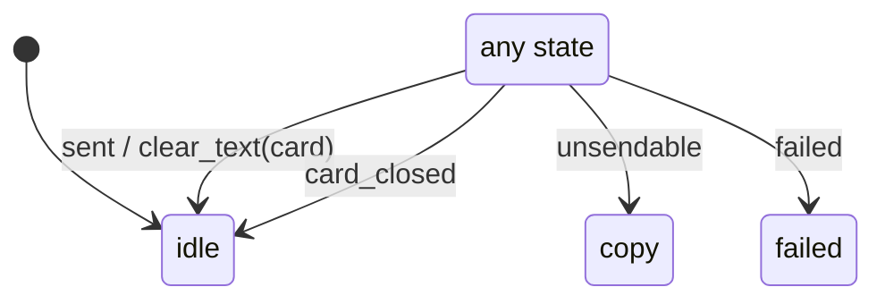

# card_ask

Generated by `mix foreman.fsm.docs`. Do not edit by hand.

| state | event | result | effects |
| --- | --- | --- | --- |
| idle | sent | -> idle | clear_text(card) |
| idle | unsendable | -> copy |  |
| idle | failed | -> failed |  |
| idle | card_closed | -> idle |  |
| copy | sent | -> idle | clear_text(card) |
| copy | unsendable | -> copy |  |
| copy | failed | -> failed |  |
| copy | card_closed | -> idle |  |
| failed | sent | -> idle | clear_text(card) |
| failed | unsendable | -> copy |  |
| failed | failed | -> failed |  |
| failed | card_closed | -> idle |  |
