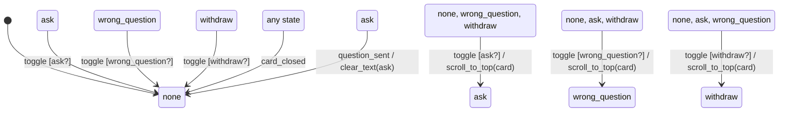

# card_footer_panel

Generated by `mix foreman.fsm.docs`. Do not edit by hand.

| state | event | result | effects |
| --- | --- | --- | --- |
| none | toggle [ask?] | -> ask | scroll_to_top(card) |
| none | toggle [wrong_question?] | -> wrong_question | scroll_to_top(card) |
| none | toggle [withdraw?] | -> withdraw | scroll_to_top(card) |
| none | toggle | invalid |  |
| none | card_closed | -> none |  |
| none | question_sent | ignored |  |
| ask | toggle [ask?] | -> none |  |
| ask | toggle [wrong_question?] | -> wrong_question | scroll_to_top(card) |
| ask | toggle [withdraw?] | -> withdraw | scroll_to_top(card) |
| ask | toggle | invalid |  |
| ask | card_closed | -> none |  |
| ask | question_sent | -> none | clear_text(ask) |
| wrong_question | toggle [wrong_question?] | -> none |  |
| wrong_question | toggle [ask?] | -> ask | scroll_to_top(card) |
| wrong_question | toggle [withdraw?] | -> withdraw | scroll_to_top(card) |
| wrong_question | toggle | invalid |  |
| wrong_question | card_closed | -> none |  |
| wrong_question | question_sent | ignored |  |
| withdraw | toggle [withdraw?] | -> none |  |
| withdraw | toggle [ask?] | -> ask | scroll_to_top(card) |
| withdraw | toggle [wrong_question?] | -> wrong_question | scroll_to_top(card) |
| withdraw | toggle | invalid |  |
| withdraw | card_closed | -> none |  |
| withdraw | question_sent | ignored |  |
