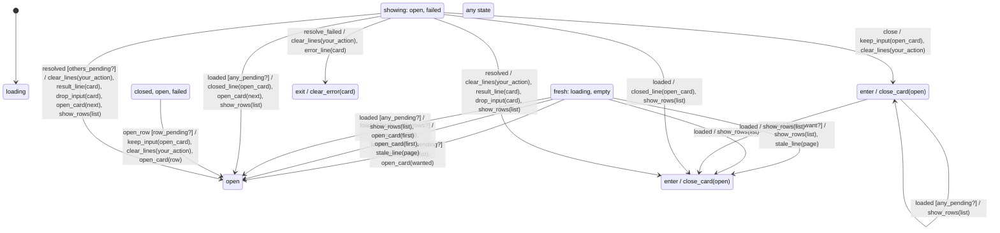

# card_list

Generated by `mix foreman.fsm.docs`. Do not edit by hand.

| state | event | result | effects |
| --- | --- | --- | --- |
| loading | loaded [wanted_pending?] | -> open | show_rows(list), open_card(wanted) |
| loading | loaded [stale_with_rows?] | -> open | show_rows(list), open_card(first), stale_line(page) |
| loading | loaded [any_pending?] | -> open | show_rows(list), open_card(first) |
| loading | loaded [stale_want?] | -> empty | show_rows(list), stale_line(page), close_card(open) |
| loading | loaded | -> empty | show_rows(list), close_card(open) |
| loading | load_failed | stay | load_error(page) |
| loading | open_row | stay | stale_line(page) |
| loading | close | ignored |  |
| loading | resolved | invalid |  |
| loading | resolve_failed | invalid |  |
| loading | line_expired | stay | remove_line(line) |
| loading | dismiss_line | stay | remove_line(line) |
| empty | loaded [wanted_pending?] | -> open | show_rows(list), open_card(wanted) |
| empty | loaded [stale_with_rows?] | -> open | show_rows(list), open_card(first), stale_line(page) |
| empty | loaded [any_pending?] | -> open | show_rows(list), open_card(first) |
| empty | loaded [stale_want?] | -> empty | show_rows(list), stale_line(page) |
| empty | loaded | -> empty | show_rows(list) |
| empty | load_failed | stay | load_error(page) |
| empty | open_row | stay | stale_line(page) |
| empty | close | ignored |  |
| empty | resolved | invalid |  |
| empty | resolve_failed | invalid |  |
| empty | line_expired | stay | remove_line(line) |
| empty | dismiss_line | stay | remove_line(line) |
| closed | loaded [any_pending?] | stay | show_rows(list) |
| closed | loaded | -> empty | show_rows(list), close_card(open) |
| closed | load_failed | stay | load_error(page) |
| closed | open_row [row_pending?] | -> open | keep_input(open_card), clear_lines(your_action), open_card(row) |
| closed | open_row | stay | stale_line(page) |
| closed | close | ignored |  |
| closed | resolved | invalid |  |
| closed | resolve_failed | invalid |  |
| closed | line_expired | stay | remove_line(line) |
| closed | dismiss_line | stay | remove_line(line) |
| open | loaded [open_pending?] | stay | show_rows(list) |
| open | loaded [any_pending?] | -> open | closed_line(open_card), open_card(next), show_rows(list) |
| open | loaded | -> empty | closed_line(open_card), show_rows(list), close_card(open) |
| open | load_failed | stay | load_error(page) |
| open | open_row [already_open?] | stay |  |
| open | open_row [row_pending?] | -> open | keep_input(open_card), clear_lines(your_action), open_card(row) |
| open | open_row | stay | stale_line(page) |
| open | close | -> closed | keep_input(open_card), clear_lines(your_action), close_card(open) |
| open | resolved [others_pending?] | -> open | clear_lines(your_action), result_line(card), drop_input(card), open_card(next), show_rows(list) |
| open | resolved | -> empty | clear_lines(your_action), result_line(card), drop_input(card), show_rows(list), close_card(open) |
| open | resolve_failed | -> failed | clear_lines(your_action), error_line(card) |
| open | line_expired | stay | remove_line(line) |
| open | dismiss_line | stay | remove_line(line) |
| failed | loaded [open_pending?] | stay | show_rows(list) |
| failed | loaded [any_pending?] | -> open | clear_error(card), closed_line(open_card), open_card(next), show_rows(list) |
| failed | loaded | -> empty | clear_error(card), closed_line(open_card), show_rows(list), close_card(open) |
| failed | load_failed | stay | load_error(page) |
| failed | open_row [already_open?] | stay |  |
| failed | open_row [row_pending?] | -> open | clear_error(card), keep_input(open_card), clear_lines(your_action), open_card(row) |
| failed | open_row | stay | stale_line(page) |
| failed | close | -> closed | clear_error(card), keep_input(open_card), clear_lines(your_action), close_card(open) |
| failed | resolved [others_pending?] | -> open | clear_error(card), clear_lines(your_action), result_line(card), drop_input(card), open_card(next), show_rows(list) |
| failed | resolved | -> empty | clear_error(card), clear_lines(your_action), result_line(card), drop_input(card), show_rows(list), close_card(open) |
| failed | resolve_failed | -> failed | clear_lines(your_action), error_line(card) |
| failed | line_expired | stay | remove_line(line) |
| failed | dismiss_line | stay | remove_line(line) |
