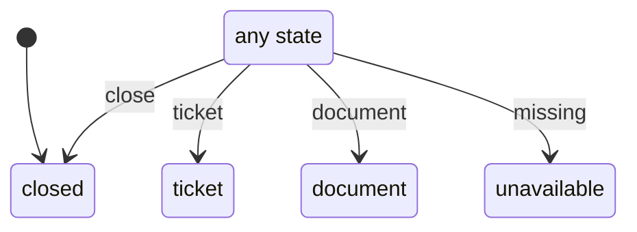

# card_panel

Generated by `mix foreman.fsm.docs`. Do not edit by hand.

| state | event | result | effects |
| --- | --- | --- | --- |
| closed | close | -> closed |  |
| closed | ticket | -> ticket |  |
| closed | document | -> document |  |
| closed | missing | -> unavailable |  |
| ticket | close | -> closed |  |
| ticket | ticket | -> ticket |  |
| ticket | document | -> document |  |
| ticket | missing | -> unavailable |  |
| document | close | -> closed |  |
| document | ticket | -> ticket |  |
| document | document | -> document |  |
| document | missing | -> unavailable |  |
| unavailable | close | -> closed |  |
| unavailable | ticket | -> ticket |  |
| unavailable | document | -> document |  |
| unavailable | missing | -> unavailable |  |
