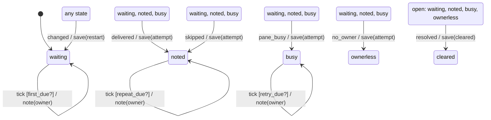

# close_out_nag

Generated by `mix foreman.fsm.docs`. Do not edit by hand.

| state | event | result | effects |
| --- | --- | --- | --- |
| waiting | tick [first_due?] | stay | note(owner) |
| waiting | tick | ignored |  |
| waiting | delivered | -> noted | save(attempt) |
| waiting | skipped | -> noted | save(attempt) |
| waiting | pane_busy | -> busy | save(attempt) |
| waiting | no_owner | -> ownerless | save(attempt) |
| waiting | changed | -> waiting | save(restart) |
| waiting | resolved | -> cleared | save(cleared) |
| noted | tick [repeat_due?] | stay | note(owner) |
| noted | tick | ignored |  |
| noted | delivered | -> noted | save(attempt) |
| noted | skipped | -> noted | save(attempt) |
| noted | pane_busy | -> busy | save(attempt) |
| noted | no_owner | -> ownerless | save(attempt) |
| noted | changed | -> waiting | save(restart) |
| noted | resolved | -> cleared | save(cleared) |
| busy | tick [retry_due?] | stay | note(owner) |
| busy | tick | ignored |  |
| busy | delivered | -> noted | save(attempt) |
| busy | skipped | -> noted | save(attempt) |
| busy | pane_busy | -> busy | save(attempt) |
| busy | no_owner | -> ownerless | save(attempt) |
| busy | changed | -> waiting | save(restart) |
| busy | resolved | -> cleared | save(cleared) |
| ownerless | tick | ignored |  |
| ownerless | delivered | invalid |  |
| ownerless | skipped | invalid |  |
| ownerless | pane_busy | invalid |  |
| ownerless | no_owner | invalid |  |
| ownerless | changed | -> waiting | save(restart) |
| ownerless | resolved | -> cleared | save(cleared) |
| cleared | tick | ignored |  |
| cleared | delivered | invalid |  |
| cleared | skipped | invalid |  |
| cleared | pane_busy | invalid |  |
| cleared | no_owner | invalid |  |
| cleared | changed | -> waiting | save(restart) |
| cleared | resolved | ignored |  |
