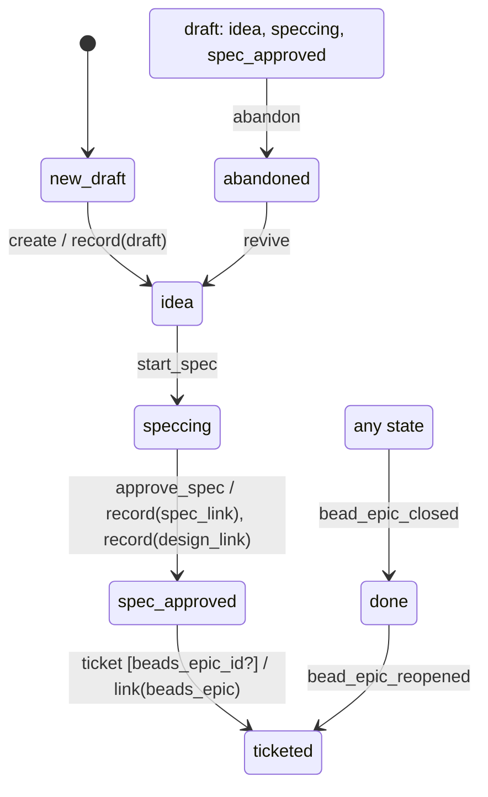

# epic

Generated by `mix foreman.fsm.docs`. Do not edit by hand.

| state | event | result | effects |
| --- | --- | --- | --- |
| new_draft | create | -> idea | record(draft) |
| new_draft | start_spec | invalid |  |
| new_draft | approve_spec | invalid |  |
| new_draft | ticket | invalid |  |
| new_draft | abandon | invalid |  |
| new_draft | revive | invalid |  |
| new_draft | bead_epic_closed | -> done |  |
| new_draft | bead_epic_reopened | ignored |  |
| idea | create | invalid |  |
| idea | start_spec | -> speccing |  |
| idea | approve_spec | invalid |  |
| idea | ticket | invalid |  |
| idea | abandon | -> abandoned |  |
| idea | revive | invalid |  |
| idea | bead_epic_closed | -> done |  |
| idea | bead_epic_reopened | ignored |  |
| speccing | create | invalid |  |
| speccing | start_spec | invalid |  |
| speccing | approve_spec | -> spec_approved | record(spec_link), record(design_link) |
| speccing | ticket | invalid |  |
| speccing | abandon | -> abandoned |  |
| speccing | revive | invalid |  |
| speccing | bead_epic_closed | -> done |  |
| speccing | bead_epic_reopened | ignored |  |
| spec_approved | create | invalid |  |
| spec_approved | start_spec | invalid |  |
| spec_approved | approve_spec | invalid |  |
| spec_approved | ticket [beads_epic_id?] | -> ticketed | link(beads_epic) |
| spec_approved | ticket | invalid |  |
| spec_approved | abandon | -> abandoned |  |
| spec_approved | revive | invalid |  |
| spec_approved | bead_epic_closed | -> done |  |
| spec_approved | bead_epic_reopened | ignored |  |
| ticketed | create | invalid |  |
| ticketed | start_spec | invalid |  |
| ticketed | approve_spec | invalid |  |
| ticketed | ticket | invalid |  |
| ticketed | abandon | invalid |  |
| ticketed | revive | invalid |  |
| ticketed | bead_epic_closed | -> done |  |
| ticketed | bead_epic_reopened | ignored |  |
| abandoned | create | invalid |  |
| abandoned | start_spec | invalid |  |
| abandoned | approve_spec | invalid |  |
| abandoned | ticket | invalid |  |
| abandoned | abandon | invalid |  |
| abandoned | revive | -> idea |  |
| abandoned | bead_epic_closed | -> done |  |
| abandoned | bead_epic_reopened | ignored |  |
| done | create | invalid |  |
| done | start_spec | invalid |  |
| done | approve_spec | invalid |  |
| done | ticket | invalid |  |
| done | abandon | invalid |  |
| done | revive | invalid |  |
| done | bead_epic_closed | -> done |  |
| done | bead_epic_reopened | -> ticketed |  |
