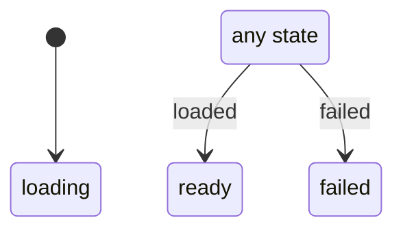

# load

Generated by `mix foreman.fsm.docs`. Do not edit by hand.

| state | event | result | effects |
| --- | --- | --- | --- |
| loading | loaded | -> ready |  |
| loading | failed | -> failed |  |
| ready | loaded | -> ready |  |
| ready | failed | -> failed |  |
| failed | loaded | -> ready |  |
| failed | failed | -> failed |  |
