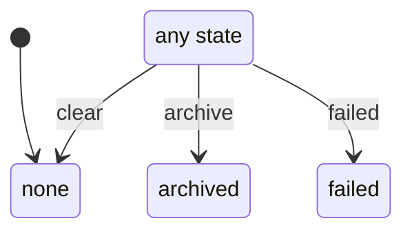

# notice

Generated by `mix foreman.fsm.docs`. Do not edit by hand.

| state | event | result | effects |
| --- | --- | --- | --- |
| none | archive | -> archived |  |
| none | failed | -> failed |  |
| none | clear | -> none |  |
| archived | archive | -> archived |  |
| archived | failed | -> failed |  |
| archived | clear | -> none |  |
| failed | archive | -> archived |  |
| failed | failed | -> failed |  |
| failed | clear | -> none |  |
