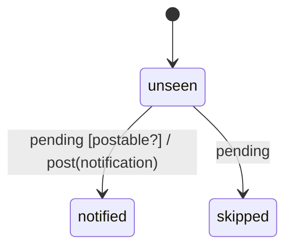

# os_notification

Generated by `mix foreman.fsm.docs`. Do not edit by hand.

| state | event | result | effects |
| --- | --- | --- | --- |
| unseen | pending [postable?] | -> notified | post(notification) |
| unseen | pending | -> skipped |  |
| notified | pending | ignored |  |
| skipped | pending | ignored |  |
