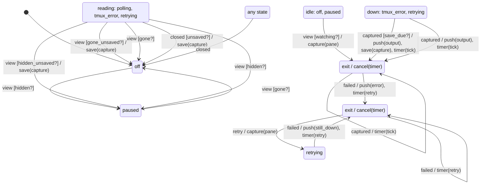

# pane_reader

Generated by `mix foreman.fsm.docs`. Do not edit by hand.

| state | event | result | effects |
| --- | --- | --- | --- |
| off | view [hidden?] | -> paused |  |
| off | view [watching?] | -> polling | capture(pane) |
| off | view | ignored |  |
| off | tick | ignored |  |
| off | captured | ignored |  |
| off | failed | ignored |  |
| off | closed | -> off |  |
| off | retry | invalid |  |
| polling | view [gone_unsaved?] | -> off | cancel(timer), save(capture) |
| polling | view [gone?] | -> off | cancel(timer) |
| polling | view [hidden_unsaved?] | -> paused | cancel(timer), save(capture) |
| polling | view [hidden?] | -> paused | cancel(timer) |
| polling | view | ignored |  |
| polling | tick | stay | capture(pane) |
| polling | captured [save_due?] | stay | push(output), save(capture), timer(tick) |
| polling | captured [changed?] | stay | push(output), timer(tick) |
| polling | captured | stay | timer(tick) |
| polling | failed | -> tmux_error | cancel(timer), push(error), timer(retry) |
| polling | closed [unsaved?] | -> off | cancel(timer), save(capture) |
| polling | closed | -> off | cancel(timer) |
| polling | retry | invalid |  |
| paused | view [gone?] | -> off |  |
| paused | view [watching?] | -> polling | capture(pane) |
| paused | view | ignored |  |
| paused | tick | ignored |  |
| paused | captured | ignored |  |
| paused | failed | ignored |  |
| paused | closed | -> off |  |
| paused | retry | invalid |  |
| tmux_error | view [gone_unsaved?] | -> off | cancel(timer), save(capture) |
| tmux_error | view [gone?] | -> off | cancel(timer) |
| tmux_error | view [hidden_unsaved?] | -> paused | cancel(timer), save(capture) |
| tmux_error | view [hidden?] | -> paused | cancel(timer) |
| tmux_error | view | ignored |  |
| tmux_error | tick | stay | capture(pane) |
| tmux_error | captured [save_due?] | -> polling | cancel(timer), push(output), save(capture), timer(tick) |
| tmux_error | captured | -> polling | cancel(timer), push(output), timer(tick) |
| tmux_error | failed | stay | timer(retry) |
| tmux_error | closed [unsaved?] | -> off | cancel(timer), save(capture) |
| tmux_error | closed | -> off | cancel(timer) |
| tmux_error | retry | -> retrying | cancel(timer), capture(pane) |
| retrying | view [gone_unsaved?] | -> off | save(capture) |
| retrying | view [gone?] | -> off |  |
| retrying | view [hidden_unsaved?] | -> paused | save(capture) |
| retrying | view [hidden?] | -> paused |  |
| retrying | view | ignored |  |
| retrying | tick | ignored |  |
| retrying | captured [save_due?] | -> polling | push(output), save(capture), timer(tick) |
| retrying | captured | -> polling | push(output), timer(tick) |
| retrying | failed | -> tmux_error | push(still_down), timer(retry) |
| retrying | closed [unsaved?] | -> off | save(capture) |
| retrying | closed | -> off |  |
| retrying | retry | invalid |  |
