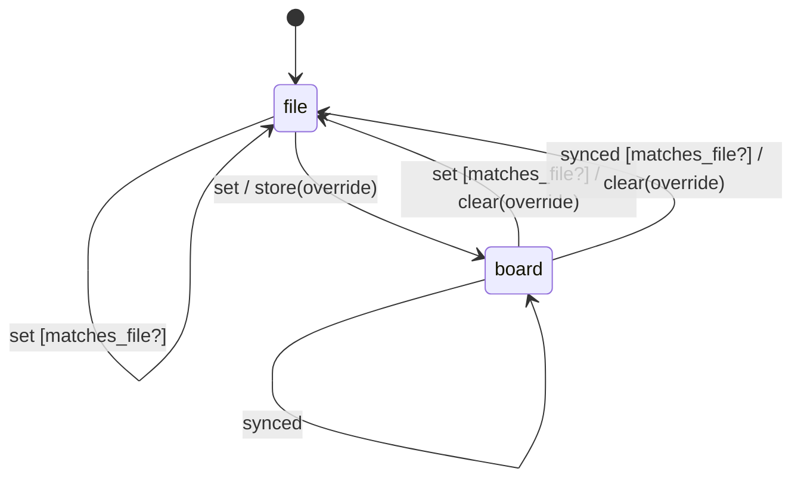

# priority_override

Generated by `mix foreman.fsm.docs`. Do not edit by hand.

| state | event | result | effects |
| --- | --- | --- | --- |
| file | set [matches_file?] | stay |  |
| file | set | -> board | store(override) |
| file | synced | ignored |  |
| board | set [matches_file?] | -> file | clear(override) |
| board | set | stay | store(override) |
| board | synced [matches_file?] | -> file | clear(override) |
| board | synced | stay |  |
