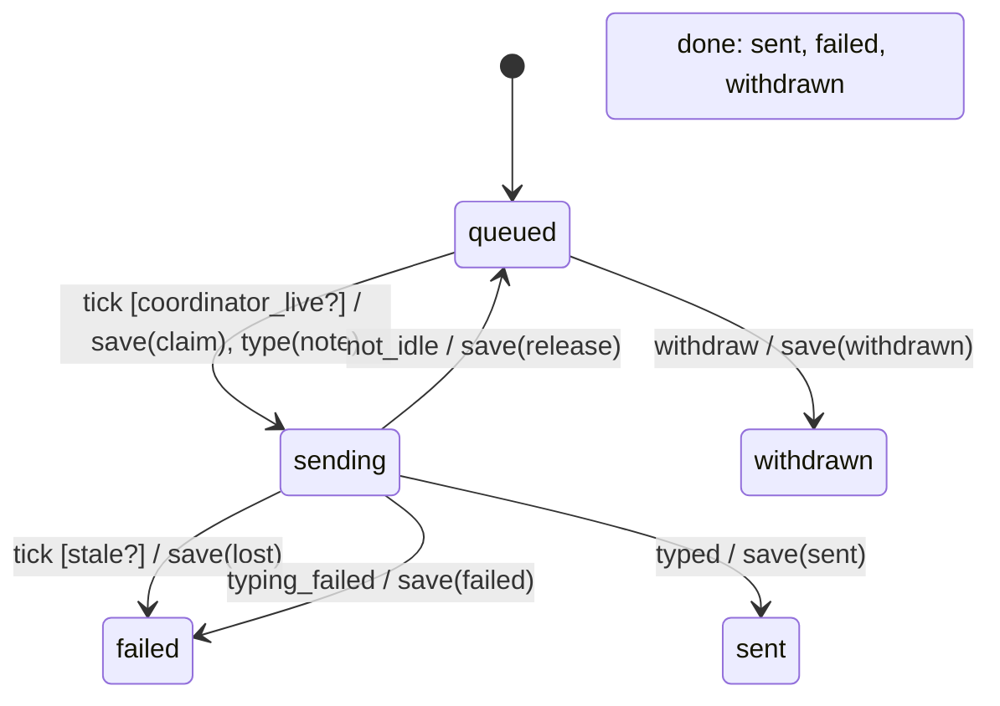

# queued_note

Generated by `mix foreman.fsm.docs`. Do not edit by hand.

| state | event | result | effects |
| --- | --- | --- | --- |
| queued | tick [coordinator_live?] | -> sending | save(claim), type(note) |
| queued | tick | ignored |  |
| queued | typed | invalid |  |
| queued | not_idle | invalid |  |
| queued | typing_failed | invalid |  |
| queued | withdraw | -> withdrawn | save(withdrawn) |
| sending | tick [stale?] | -> failed | save(lost) |
| sending | tick | ignored |  |
| sending | typed | -> sent | save(sent) |
| sending | not_idle | -> queued | save(release) |
| sending | typing_failed | -> failed | save(failed) |
| sending | withdraw | invalid |  |
| sent | tick | ignored |  |
| sent | typed | invalid |  |
| sent | not_idle | invalid |  |
| sent | typing_failed | invalid |  |
| sent | withdraw | invalid |  |
| failed | tick | ignored |  |
| failed | typed | invalid |  |
| failed | not_idle | invalid |  |
| failed | typing_failed | invalid |  |
| failed | withdraw | invalid |  |
| withdrawn | tick | ignored |  |
| withdrawn | typed | invalid |  |
| withdrawn | not_idle | invalid |  |
| withdrawn | typing_failed | invalid |  |
| withdrawn | withdraw | invalid |  |
