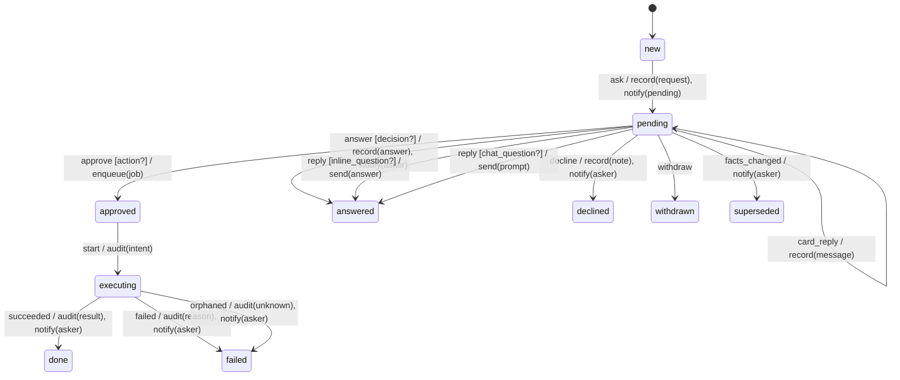

# request

Generated by `mix foreman.fsm.docs`. Do not edit by hand.

| state | event | result | effects |
| --- | --- | --- | --- |
| new | ask | -> pending | record(request), notify(pending) |
| new | approve | invalid |  |
| new | answer | invalid |  |
| new | decline | invalid |  |
| new | withdraw | invalid |  |
| new | continue | invalid |  |
| new | reply | invalid |  |
| new | card_question | invalid |  |
| new | card_reply | invalid |  |
| new | start | invalid |  |
| new | facts_changed | ignored |  |
| new | succeeded | ignored |  |
| new | failed | ignored |  |
| new | orphaned | ignored |  |
| pending | ask | invalid |  |
| pending | approve [action?] | -> approved | enqueue(job) |
| pending | approve | invalid |  |
| pending | answer [decision?] | -> answered | record(answer), notify(asker) |
| pending | answer | invalid |  |
| pending | decline | -> declined | record(note), notify(asker) |
| pending | withdraw | -> withdrawn |  |
| pending | continue [usage_limit?] | -> pending | send(continue) |
| pending | continue | invalid |  |
| pending | reply [inline_question?] | -> answered | send(answer) |
| pending | reply [chat_question?] | -> answered | send(prompt) |
| pending | reply | invalid |  |
| pending | card_question | -> pending | send(prompt) |
| pending | card_reply | -> pending | record(message) |
| pending | start | invalid |  |
| pending | facts_changed | -> superseded | notify(asker) |
| pending | succeeded | ignored |  |
| pending | failed | ignored |  |
| pending | orphaned | ignored |  |
| approved | ask | invalid |  |
| approved | approve | invalid |  |
| approved | answer | invalid |  |
| approved | decline | invalid |  |
| approved | withdraw | invalid |  |
| approved | continue | invalid |  |
| approved | reply | invalid |  |
| approved | card_question | invalid |  |
| approved | card_reply | invalid |  |
| approved | start | -> executing | audit(intent) |
| approved | facts_changed | ignored |  |
| approved | succeeded | ignored |  |
| approved | failed | ignored |  |
| approved | orphaned | ignored |  |
| answered | ask | invalid |  |
| answered | approve | invalid |  |
| answered | answer | invalid |  |
| answered | decline | invalid |  |
| answered | withdraw | invalid |  |
| answered | continue | invalid |  |
| answered | reply | invalid |  |
| answered | card_question | invalid |  |
| answered | card_reply | invalid |  |
| answered | start | invalid |  |
| answered | facts_changed | ignored |  |
| answered | succeeded | ignored |  |
| answered | failed | ignored |  |
| answered | orphaned | ignored |  |
| declined | ask | invalid |  |
| declined | approve | invalid |  |
| declined | answer | invalid |  |
| declined | decline | invalid |  |
| declined | withdraw | invalid |  |
| declined | continue | invalid |  |
| declined | reply | invalid |  |
| declined | card_question | invalid |  |
| declined | card_reply | invalid |  |
| declined | start | invalid |  |
| declined | facts_changed | ignored |  |
| declined | succeeded | ignored |  |
| declined | failed | ignored |  |
| declined | orphaned | ignored |  |
| withdrawn | ask | invalid |  |
| withdrawn | approve | invalid |  |
| withdrawn | answer | invalid |  |
| withdrawn | decline | invalid |  |
| withdrawn | withdraw | invalid |  |
| withdrawn | continue | invalid |  |
| withdrawn | reply | invalid |  |
| withdrawn | card_question | invalid |  |
| withdrawn | card_reply | invalid |  |
| withdrawn | start | invalid |  |
| withdrawn | facts_changed | ignored |  |
| withdrawn | succeeded | ignored |  |
| withdrawn | failed | ignored |  |
| withdrawn | orphaned | ignored |  |
| superseded | ask | invalid |  |
| superseded | approve | invalid |  |
| superseded | answer | invalid |  |
| superseded | decline | invalid |  |
| superseded | withdraw | invalid |  |
| superseded | continue | invalid |  |
| superseded | reply | invalid |  |
| superseded | card_question | invalid |  |
| superseded | card_reply | invalid |  |
| superseded | start | invalid |  |
| superseded | facts_changed | ignored |  |
| superseded | succeeded | ignored |  |
| superseded | failed | ignored |  |
| superseded | orphaned | ignored |  |
| executing | ask | invalid |  |
| executing | approve | invalid |  |
| executing | answer | invalid |  |
| executing | decline | invalid |  |
| executing | withdraw | invalid |  |
| executing | continue | invalid |  |
| executing | reply | invalid |  |
| executing | card_question | invalid |  |
| executing | card_reply | invalid |  |
| executing | start | invalid |  |
| executing | facts_changed | ignored |  |
| executing | succeeded | -> done | audit(result), notify(asker) |
| executing | failed | -> failed | audit(reason), notify(asker) |
| executing | orphaned | -> failed | audit(unknown), notify(asker) |
| done | ask | invalid |  |
| done | approve | invalid |  |
| done | answer | invalid |  |
| done | decline | invalid |  |
| done | withdraw | invalid |  |
| done | continue | invalid |  |
| done | reply | invalid |  |
| done | card_question | invalid |  |
| done | card_reply | invalid |  |
| done | start | invalid |  |
| done | facts_changed | ignored |  |
| done | succeeded | ignored |  |
| done | failed | ignored |  |
| done | orphaned | ignored |  |
| failed | ask | invalid |  |
| failed | approve | invalid |  |
| failed | answer | invalid |  |
| failed | decline | invalid |  |
| failed | withdraw | invalid |  |
| failed | continue | invalid |  |
| failed | reply | invalid |  |
| failed | card_question | invalid |  |
| failed | card_reply | invalid |  |
| failed | start | invalid |  |
| failed | facts_changed | ignored |  |
| failed | succeeded | ignored |  |
| failed | failed | ignored |  |
| failed | orphaned | ignored |  |
