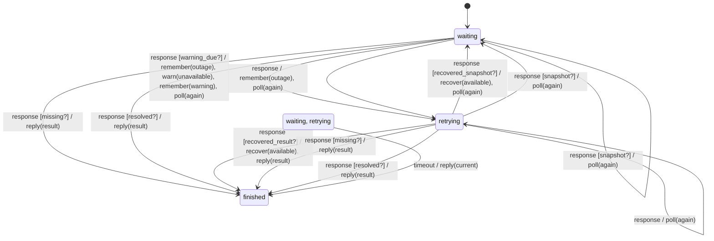

# request_wait

Generated by `mix foreman.fsm.docs`. Do not edit by hand.

| state | event | result | effects |
| --- | --- | --- | --- |
| waiting | response [missing?] | -> finished | reply(result) |
| waiting | response [resolved?] | -> finished | reply(result) |
| waiting | response [snapshot?] | stay | poll(again) |
| waiting | response [warning_due?] | -> retrying | remember(outage), warn(unavailable), remember(warning), poll(again) |
| waiting | response | -> retrying | remember(outage), poll(again) |
| waiting | timeout | -> finished | reply(current) |
| retrying | response [recovered_result?] | -> finished | recover(available), reply(result) |
| retrying | response [missing?] | -> finished | reply(result) |
| retrying | response [resolved?] | -> finished | reply(result) |
| retrying | response [recovered_snapshot?] | -> waiting | recover(available), poll(again) |
| retrying | response [snapshot?] | -> waiting | poll(again) |
| retrying | response [warning_due?] | stay | warn(unavailable), remember(warning), poll(again) |
| retrying | response | stay | poll(again) |
| retrying | timeout | -> finished | reply(current) |
| finished | response | invalid |  |
| finished | timeout | invalid |  |
