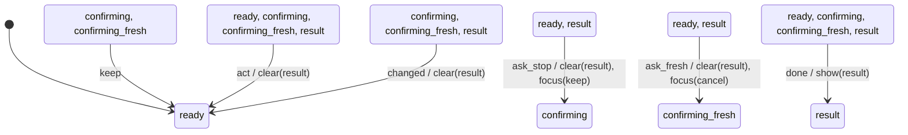

# session_control_panel

Generated by `mix foreman.fsm.docs`. Do not edit by hand.

| state | event | result | effects |
| --- | --- | --- | --- |
| ready | ask_stop | -> confirming | clear(result), focus(keep) |
| ready | ask_fresh | -> confirming_fresh | clear(result), focus(cancel) |
| ready | keep | invalid |  |
| ready | done | -> result | show(result) |
| ready | act | -> ready | clear(result) |
| ready | changed | ignored |  |
| confirming | ask_stop | invalid |  |
| confirming | ask_fresh | invalid |  |
| confirming | keep | -> ready |  |
| confirming | done | -> result | show(result) |
| confirming | act | -> ready | clear(result) |
| confirming | changed | -> ready | clear(result) |
| confirming_fresh | ask_stop | invalid |  |
| confirming_fresh | ask_fresh | invalid |  |
| confirming_fresh | keep | -> ready |  |
| confirming_fresh | done | -> result | show(result) |
| confirming_fresh | act | -> ready | clear(result) |
| confirming_fresh | changed | -> ready | clear(result) |
| result | ask_stop | -> confirming | clear(result), focus(keep) |
| result | ask_fresh | -> confirming_fresh | clear(result), focus(cancel) |
| result | keep | invalid |  |
| result | done | -> result | show(result) |
| result | act | -> ready | clear(result) |
| result | changed | -> ready | clear(result) |
