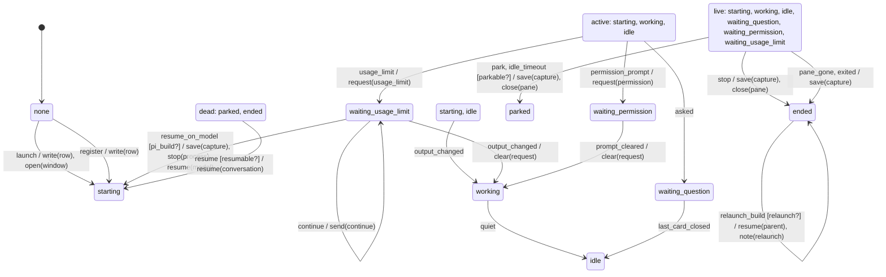

# session_lifecycle

Generated by `mix foreman.fsm.docs`. Do not edit by hand.

| state | event | result | effects |
| --- | --- | --- | --- |
| none | launch | -> starting | write(row), open(window) |
| none | register | -> starting | write(row) |
| none | continue | invalid |  |
| none | focus | invalid |  |
| none | message | invalid |  |
| none | resume_on_model | invalid |  |
| none | park | invalid |  |
| none | stop | invalid |  |
| none | resume | invalid |  |
| none | start_fresh | invalid |  |
| none | relaunch_build | invalid |  |
| none | output_changed | ignored |  |
| none | quiet | ignored |  |
| none | asked | ignored |  |
| none | last_card_closed | ignored |  |
| none | permission_prompt | ignored |  |
| none | usage_limit | ignored |  |
| none | prompt_cleared | ignored |  |
| none | idle_timeout | ignored |  |
| none | pane_gone | ignored |  |
| none | exited | ignored |  |
| starting | launch | invalid |  |
| starting | register | invalid |  |
| starting | continue | invalid |  |
| starting | focus | stay | show(pane) |
| starting | message | invalid |  |
| starting | resume_on_model | invalid |  |
| starting | park [parkable?] | -> parked | save(capture), close(pane) |
| starting | park | invalid |  |
| starting | stop | -> ended | save(capture), close(pane) |
| starting | resume | invalid |  |
| starting | start_fresh | invalid |  |
| starting | relaunch_build | invalid |  |
| starting | output_changed | -> working |  |
| starting | quiet | ignored |  |
| starting | asked | -> waiting_question |  |
| starting | last_card_closed | ignored |  |
| starting | permission_prompt | -> waiting_permission | request(permission) |
| starting | usage_limit | -> waiting_usage_limit | request(usage_limit) |
| starting | prompt_cleared | ignored |  |
| starting | idle_timeout [parkable?] | -> parked | save(capture), close(pane) |
| starting | idle_timeout | ignored |  |
| starting | pane_gone | -> ended | save(capture) |
| starting | exited | -> ended | save(capture) |
| working | launch | invalid |  |
| working | register | invalid |  |
| working | continue | invalid |  |
| working | focus | stay | show(pane) |
| working | message | invalid |  |
| working | resume_on_model | invalid |  |
| working | park [parkable?] | -> parked | save(capture), close(pane) |
| working | park | invalid |  |
| working | stop | -> ended | save(capture), close(pane) |
| working | resume | invalid |  |
| working | start_fresh | invalid |  |
| working | relaunch_build | invalid |  |
| working | output_changed | ignored |  |
| working | quiet | -> idle |  |
| working | asked | -> waiting_question |  |
| working | last_card_closed | ignored |  |
| working | permission_prompt | -> waiting_permission | request(permission) |
| working | usage_limit | -> waiting_usage_limit | request(usage_limit) |
| working | prompt_cleared | ignored |  |
| working | idle_timeout [parkable?] | -> parked | save(capture), close(pane) |
| working | idle_timeout | ignored |  |
| working | pane_gone | -> ended | save(capture) |
| working | exited | -> ended | save(capture) |
| idle | launch | invalid |  |
| idle | register | invalid |  |
| idle | continue | invalid |  |
| idle | focus | stay | show(pane) |
| idle | message | stay | send(message) |
| idle | resume_on_model | invalid |  |
| idle | park [parkable?] | -> parked | save(capture), close(pane) |
| idle | park | invalid |  |
| idle | stop | -> ended | save(capture), close(pane) |
| idle | resume | invalid |  |
| idle | start_fresh | invalid |  |
| idle | relaunch_build | invalid |  |
| idle | output_changed | -> working |  |
| idle | quiet | ignored |  |
| idle | asked | -> waiting_question |  |
| idle | last_card_closed | ignored |  |
| idle | permission_prompt | -> waiting_permission | request(permission) |
| idle | usage_limit | -> waiting_usage_limit | request(usage_limit) |
| idle | prompt_cleared | ignored |  |
| idle | idle_timeout [parkable?] | -> parked | save(capture), close(pane) |
| idle | idle_timeout | ignored |  |
| idle | pane_gone | -> ended | save(capture) |
| idle | exited | -> ended | save(capture) |
| waiting_question | launch | invalid |  |
| waiting_question | register | invalid |  |
| waiting_question | continue | invalid |  |
| waiting_question | focus | stay | show(pane) |
| waiting_question | message | stay | send(message) |
| waiting_question | resume_on_model | invalid |  |
| waiting_question | park [parkable?] | -> parked | save(capture), close(pane) |
| waiting_question | park | invalid |  |
| waiting_question | stop | -> ended | save(capture), close(pane) |
| waiting_question | resume | invalid |  |
| waiting_question | start_fresh | invalid |  |
| waiting_question | relaunch_build | invalid |  |
| waiting_question | output_changed | ignored |  |
| waiting_question | quiet | ignored |  |
| waiting_question | asked | ignored |  |
| waiting_question | last_card_closed | -> idle |  |
| waiting_question | permission_prompt | ignored |  |
| waiting_question | usage_limit | ignored |  |
| waiting_question | prompt_cleared | ignored |  |
| waiting_question | idle_timeout [parkable?] | -> parked | save(capture), close(pane) |
| waiting_question | idle_timeout | ignored |  |
| waiting_question | pane_gone | -> ended | save(capture) |
| waiting_question | exited | -> ended | save(capture) |
| waiting_permission | launch | invalid |  |
| waiting_permission | register | invalid |  |
| waiting_permission | continue | invalid |  |
| waiting_permission | focus | stay | show(pane) |
| waiting_permission | message | invalid |  |
| waiting_permission | resume_on_model | invalid |  |
| waiting_permission | park [parkable?] | -> parked | save(capture), close(pane) |
| waiting_permission | park | invalid |  |
| waiting_permission | stop | -> ended | save(capture), close(pane) |
| waiting_permission | resume | invalid |  |
| waiting_permission | start_fresh | invalid |  |
| waiting_permission | relaunch_build | invalid |  |
| waiting_permission | output_changed | ignored |  |
| waiting_permission | quiet | ignored |  |
| waiting_permission | asked | ignored |  |
| waiting_permission | last_card_closed | ignored |  |
| waiting_permission | permission_prompt | ignored |  |
| waiting_permission | usage_limit | ignored |  |
| waiting_permission | prompt_cleared | -> working | clear(request) |
| waiting_permission | idle_timeout [parkable?] | -> parked | save(capture), close(pane) |
| waiting_permission | idle_timeout | ignored |  |
| waiting_permission | pane_gone | -> ended | save(capture) |
| waiting_permission | exited | -> ended | save(capture) |
| waiting_usage_limit | launch | invalid |  |
| waiting_usage_limit | register | invalid |  |
| waiting_usage_limit | continue | stay | send(continue) |
| waiting_usage_limit | focus | stay | show(pane) |
| waiting_usage_limit | message | invalid |  |
| waiting_usage_limit | resume_on_model [pi_build?] | -> starting | save(capture), stop(process), resume(model) |
| waiting_usage_limit | resume_on_model | invalid |  |
| waiting_usage_limit | park [parkable?] | -> parked | save(capture), close(pane) |
| waiting_usage_limit | park | invalid |  |
| waiting_usage_limit | stop | -> ended | save(capture), close(pane) |
| waiting_usage_limit | resume | invalid |  |
| waiting_usage_limit | start_fresh | invalid |  |
| waiting_usage_limit | relaunch_build | invalid |  |
| waiting_usage_limit | output_changed | -> working | clear(request) |
| waiting_usage_limit | quiet | ignored |  |
| waiting_usage_limit | asked | ignored |  |
| waiting_usage_limit | last_card_closed | ignored |  |
| waiting_usage_limit | permission_prompt | ignored |  |
| waiting_usage_limit | usage_limit | ignored |  |
| waiting_usage_limit | prompt_cleared | ignored |  |
| waiting_usage_limit | idle_timeout [parkable?] | -> parked | save(capture), close(pane) |
| waiting_usage_limit | idle_timeout | ignored |  |
| waiting_usage_limit | pane_gone | -> ended | save(capture) |
| waiting_usage_limit | exited | -> ended | save(capture) |
| parked | launch | invalid |  |
| parked | register | invalid |  |
| parked | continue | invalid |  |
| parked | focus | invalid |  |
| parked | message | invalid |  |
| parked | resume_on_model | invalid |  |
| parked | park | invalid |  |
| parked | stop | invalid |  |
| parked | resume [resumable?] | -> starting | resume(conversation) |
| parked | resume | invalid |  |
| parked | start_fresh [fresh?] | stay | create(row), move(builds) |
| parked | start_fresh | invalid |  |
| parked | relaunch_build | invalid |  |
| parked | output_changed | ignored |  |
| parked | quiet | ignored |  |
| parked | asked | ignored |  |
| parked | last_card_closed | ignored |  |
| parked | permission_prompt | ignored |  |
| parked | usage_limit | ignored |  |
| parked | prompt_cleared | ignored |  |
| parked | idle_timeout | ignored |  |
| parked | pane_gone | ignored |  |
| parked | exited | ignored |  |
| ended | launch | invalid |  |
| ended | register | invalid |  |
| ended | continue | invalid |  |
| ended | focus | invalid |  |
| ended | message | invalid |  |
| ended | resume_on_model | invalid |  |
| ended | park | invalid |  |
| ended | stop | invalid |  |
| ended | resume [resumable?] | -> starting | resume(conversation) |
| ended | resume | invalid |  |
| ended | start_fresh [fresh?] | stay | create(row), move(builds) |
| ended | start_fresh | invalid |  |
| ended | relaunch_build [relaunch?] | stay | resume(parent), note(relaunch) |
| ended | relaunch_build | invalid |  |
| ended | output_changed | ignored |  |
| ended | quiet | ignored |  |
| ended | asked | ignored |  |
| ended | last_card_closed | ignored |  |
| ended | permission_prompt | ignored |  |
| ended | usage_limit | ignored |  |
| ended | prompt_cleared | ignored |  |
| ended | idle_timeout | ignored |  |
| ended | pane_gone | ignored |  |
| ended | exited | ignored |  |
