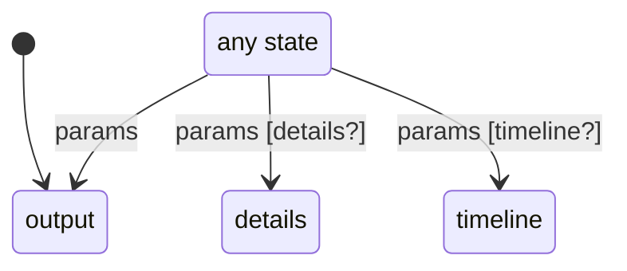

# session_page

Generated by `mix foreman.fsm.docs`. Do not edit by hand.

| state | event | result | effects |
| --- | --- | --- | --- |
| output | params [details?] | -> details |  |
| output | params [timeline?] | -> timeline |  |
| output | params | -> output |  |
| timeline | params [details?] | -> details |  |
| timeline | params [timeline?] | -> timeline |  |
| timeline | params | -> output |  |
| details | params [details?] | -> details |  |
| details | params [timeline?] | -> timeline |  |
| details | params | -> output |  |
