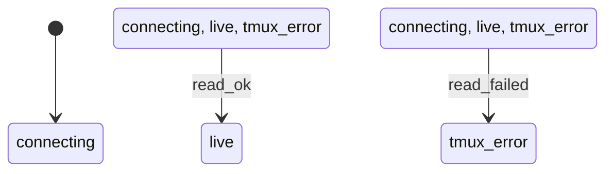

# sessions_connection

Generated by `mix foreman.fsm.docs`. Do not edit by hand.

| state | event | result | effects |
| --- | --- | --- | --- |
| connecting | read_ok | -> live |  |
| connecting | read_failed | -> tmux_error |  |
| live | read_ok | -> live |  |
| live | read_failed | -> tmux_error |  |
| tmux_error | read_ok | -> live |  |
| tmux_error | read_failed | -> tmux_error |  |
