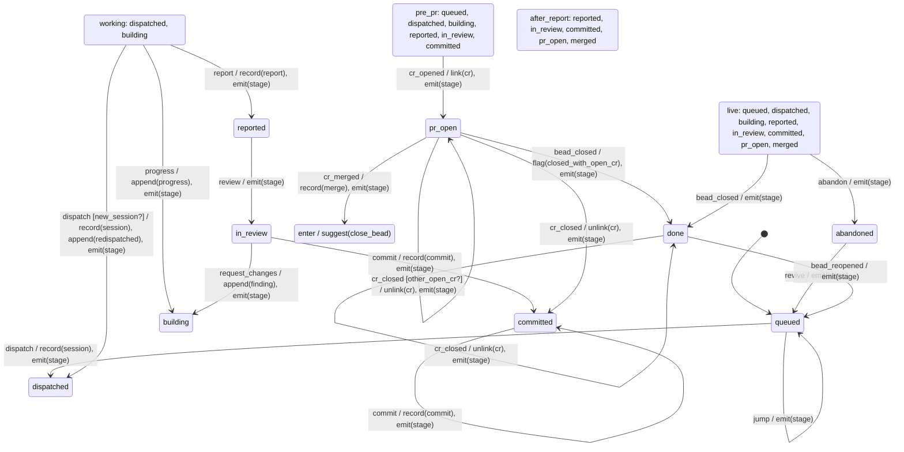

# stage

Generated by `mix foreman.fsm.docs`. Do not edit by hand.

| state | event | result | effects |
| --- | --- | --- | --- |
| queued | dispatch | -> dispatched | record(session), emit(stage) |
| queued | progress | invalid |  |
| queued | report | invalid |  |
| queued | review | invalid |  |
| queued | request_changes | invalid |  |
| queued | commit | invalid |  |
| queued | abandon | -> abandoned | emit(stage) |
| queued | revive | invalid |  |
| queued | cr_opened | -> pr_open | link(cr), emit(stage) |
| queued | cr_closed | ignored |  |
| queued | cr_merged | ignored |  |
| queued | bead_closed | -> done | emit(stage) |
| queued | bead_reopened | ignored |  |
| queued | jump | stay | emit(stage) |
| dispatched | dispatch [new_session?] | -> dispatched | record(session), append(redispatched), emit(stage) |
| dispatched | dispatch | invalid |  |
| dispatched | progress | -> building | append(progress), emit(stage) |
| dispatched | report | -> reported | record(report), emit(stage) |
| dispatched | review | invalid |  |
| dispatched | request_changes | invalid |  |
| dispatched | commit | invalid |  |
| dispatched | abandon | -> abandoned | emit(stage) |
| dispatched | revive | invalid |  |
| dispatched | cr_opened | -> pr_open | link(cr), emit(stage) |
| dispatched | cr_closed | ignored |  |
| dispatched | cr_merged | ignored |  |
| dispatched | bead_closed | -> done | emit(stage) |
| dispatched | bead_reopened | ignored |  |
| dispatched | jump | ignored |  |
| building | dispatch [new_session?] | -> dispatched | record(session), append(redispatched), emit(stage) |
| building | dispatch | invalid |  |
| building | progress | -> building | append(progress), emit(stage) |
| building | report | -> reported | record(report), emit(stage) |
| building | review | invalid |  |
| building | request_changes | invalid |  |
| building | commit | invalid |  |
| building | abandon | -> abandoned | emit(stage) |
| building | revive | invalid |  |
| building | cr_opened | -> pr_open | link(cr), emit(stage) |
| building | cr_closed | ignored |  |
| building | cr_merged | ignored |  |
| building | bead_closed | -> done | emit(stage) |
| building | bead_reopened | ignored |  |
| building | jump | ignored |  |
| reported | dispatch | invalid |  |
| reported | progress | stay | append(progress), emit(stage) |
| reported | report | invalid |  |
| reported | review | -> in_review | emit(stage) |
| reported | request_changes | invalid |  |
| reported | commit | invalid |  |
| reported | abandon | -> abandoned | emit(stage) |
| reported | revive | invalid |  |
| reported | cr_opened | -> pr_open | link(cr), emit(stage) |
| reported | cr_closed | ignored |  |
| reported | cr_merged | ignored |  |
| reported | bead_closed | -> done | emit(stage) |
| reported | bead_reopened | ignored |  |
| reported | jump | ignored |  |
| in_review | dispatch | invalid |  |
| in_review | progress | stay | append(progress), emit(stage) |
| in_review | report | invalid |  |
| in_review | review | invalid |  |
| in_review | request_changes | -> building | append(finding), emit(stage) |
| in_review | commit | -> committed | record(commit), emit(stage) |
| in_review | abandon | -> abandoned | emit(stage) |
| in_review | revive | invalid |  |
| in_review | cr_opened | -> pr_open | link(cr), emit(stage) |
| in_review | cr_closed | ignored |  |
| in_review | cr_merged | ignored |  |
| in_review | bead_closed | -> done | emit(stage) |
| in_review | bead_reopened | ignored |  |
| in_review | jump | ignored |  |
| committed | dispatch | invalid |  |
| committed | progress | stay | append(progress), emit(stage) |
| committed | report | invalid |  |
| committed | review | invalid |  |
| committed | request_changes | invalid |  |
| committed | commit | stay | record(commit), emit(stage) |
| committed | abandon | -> abandoned | emit(stage) |
| committed | revive | invalid |  |
| committed | cr_opened | -> pr_open | link(cr), emit(stage) |
| committed | cr_closed | ignored |  |
| committed | cr_merged | ignored |  |
| committed | bead_closed | -> done | emit(stage) |
| committed | bead_reopened | ignored |  |
| committed | jump | ignored |  |
| pr_open | dispatch | invalid |  |
| pr_open | progress | stay | append(progress), emit(stage) |
| pr_open | report | invalid |  |
| pr_open | review | invalid |  |
| pr_open | request_changes | invalid |  |
| pr_open | commit | invalid |  |
| pr_open | abandon | -> abandoned | emit(stage) |
| pr_open | revive | invalid |  |
| pr_open | cr_opened | stay | link(cr), emit(stage) |
| pr_open | cr_closed [other_open_cr?] | stay | unlink(cr), emit(stage) |
| pr_open | cr_closed | -> committed | unlink(cr), emit(stage) |
| pr_open | cr_merged | -> merged | record(merge), emit(stage), suggest(close_bead) |
| pr_open | bead_closed | -> done | flag(closed_with_open_cr), emit(stage) |
| pr_open | bead_reopened | ignored |  |
| pr_open | jump | ignored |  |
| merged | dispatch | invalid |  |
| merged | progress | stay | append(progress), emit(stage) |
| merged | report | invalid |  |
| merged | review | invalid |  |
| merged | request_changes | invalid |  |
| merged | commit | invalid |  |
| merged | abandon | -> abandoned | emit(stage) |
| merged | revive | invalid |  |
| merged | cr_opened | stay | link(cr), emit(stage) |
| merged | cr_closed | ignored |  |
| merged | cr_merged | ignored |  |
| merged | bead_closed | -> done | emit(stage) |
| merged | bead_reopened | ignored |  |
| merged | jump | ignored |  |
| done | dispatch | invalid |  |
| done | progress | invalid |  |
| done | report | invalid |  |
| done | review | invalid |  |
| done | request_changes | invalid |  |
| done | commit | invalid |  |
| done | abandon | invalid |  |
| done | revive | invalid |  |
| done | cr_opened | ignored |  |
| done | cr_closed | stay | unlink(cr), emit(stage) |
| done | cr_merged | stay | unlink(cr), emit(stage) |
| done | bead_closed | ignored |  |
| done | bead_reopened | -> queued | emit(stage) |
| done | jump | ignored |  |
| abandoned | dispatch | invalid |  |
| abandoned | progress | invalid |  |
| abandoned | report | invalid |  |
| abandoned | review | invalid |  |
| abandoned | request_changes | invalid |  |
| abandoned | commit | invalid |  |
| abandoned | abandon | invalid |  |
| abandoned | revive | -> queued | emit(stage) |
| abandoned | cr_opened | ignored |  |
| abandoned | cr_closed | ignored |  |
| abandoned | cr_merged | ignored |  |
| abandoned | bead_closed | ignored |  |
| abandoned | bead_reopened | ignored |  |
| abandoned | jump | ignored |  |
