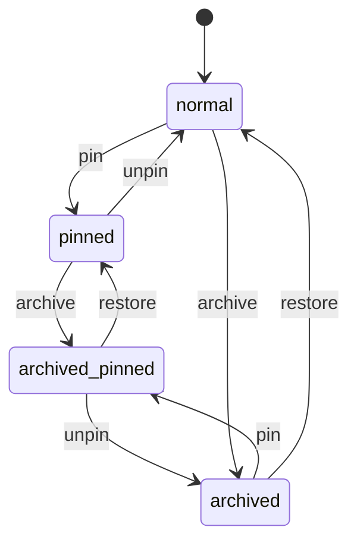

# state

Generated by `mix foreman.fsm.docs`. Do not edit by hand.

| state | event | result | effects |
| --- | --- | --- | --- |
| normal | pin | -> pinned |  |
| normal | unpin | ignored |  |
| normal | archive | -> archived |  |
| normal | restore | ignored |  |
| pinned | pin | ignored |  |
| pinned | unpin | -> normal |  |
| pinned | archive | -> archived_pinned |  |
| pinned | restore | ignored |  |
| archived | pin | -> archived_pinned |  |
| archived | unpin | ignored |  |
| archived | archive | ignored |  |
| archived | restore | -> normal |  |
| archived_pinned | pin | ignored |  |
| archived_pinned | unpin | -> archived |  |
| archived_pinned | archive | ignored |  |
| archived_pinned | restore | -> pinned |  |
