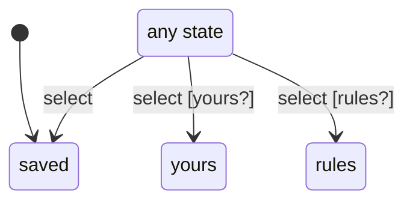

# tab

Generated by `mix foreman.fsm.docs`. Do not edit by hand.

| state | event | result | effects |
| --- | --- | --- | --- |
| saved | select [yours?] | -> yours |  |
| saved | select [rules?] | -> rules |  |
| saved | select | -> saved |  |
| yours | select [yours?] | -> yours |  |
| yours | select [rules?] | -> rules |  |
| yours | select | -> saved |  |
| rules | select [yours?] | -> yours |  |
| rules | select [rules?] | -> rules |  |
| rules | select | -> saved |  |
