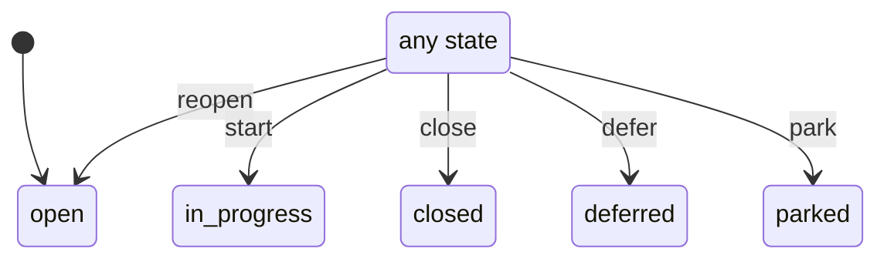

# ticket_status_machine

Generated by `mix foreman.fsm.docs`. Do not edit by hand.

| state | event | result | effects |
| --- | --- | --- | --- |
| open | reopen | -> open |  |
| open | start | -> in_progress |  |
| open | close | -> closed |  |
| open | defer | -> deferred |  |
| open | park | -> parked |  |
| in_progress | reopen | -> open |  |
| in_progress | start | -> in_progress |  |
| in_progress | close | -> closed |  |
| in_progress | defer | -> deferred |  |
| in_progress | park | -> parked |  |
| closed | reopen | -> open |  |
| closed | start | -> in_progress |  |
| closed | close | -> closed |  |
| closed | defer | -> deferred |  |
| closed | park | -> parked |  |
| deferred | reopen | -> open |  |
| deferred | start | -> in_progress |  |
| deferred | close | -> closed |  |
| deferred | defer | -> deferred |  |
| deferred | park | -> parked |  |
| parked | reopen | -> open |  |
| parked | start | -> in_progress |  |
| parked | close | -> closed |  |
| parked | defer | -> deferred |  |
| parked | park | -> parked |  |
