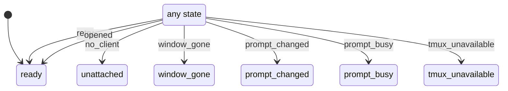

# waiting_card

Generated by `mix foreman.fsm.docs`. Do not edit by hand.

| state | event | result | effects |
| --- | --- | --- | --- |
| ready | retry | -> ready |  |
| ready | opened | -> ready |  |
| ready | no_client | -> unattached |  |
| ready | window_gone | -> window_gone |  |
| ready | prompt_changed | -> prompt_changed |  |
| ready | prompt_busy | -> prompt_busy |  |
| ready | tmux_unavailable | -> tmux_unavailable |  |
| unattached | retry | -> ready |  |
| unattached | opened | -> ready |  |
| unattached | no_client | -> unattached |  |
| unattached | window_gone | -> window_gone |  |
| unattached | prompt_changed | -> prompt_changed |  |
| unattached | prompt_busy | -> prompt_busy |  |
| unattached | tmux_unavailable | -> tmux_unavailable |  |
| window_gone | retry | -> ready |  |
| window_gone | opened | -> ready |  |
| window_gone | no_client | -> unattached |  |
| window_gone | window_gone | -> window_gone |  |
| window_gone | prompt_changed | -> prompt_changed |  |
| window_gone | prompt_busy | -> prompt_busy |  |
| window_gone | tmux_unavailable | -> tmux_unavailable |  |
| prompt_changed | retry | -> ready |  |
| prompt_changed | opened | -> ready |  |
| prompt_changed | no_client | -> unattached |  |
| prompt_changed | window_gone | -> window_gone |  |
| prompt_changed | prompt_changed | -> prompt_changed |  |
| prompt_changed | prompt_busy | -> prompt_busy |  |
| prompt_changed | tmux_unavailable | -> tmux_unavailable |  |
| prompt_busy | retry | -> ready |  |
| prompt_busy | opened | -> ready |  |
| prompt_busy | no_client | -> unattached |  |
| prompt_busy | window_gone | -> window_gone |  |
| prompt_busy | prompt_changed | -> prompt_changed |  |
| prompt_busy | prompt_busy | -> prompt_busy |  |
| prompt_busy | tmux_unavailable | -> tmux_unavailable |  |
| tmux_unavailable | retry | -> ready |  |
| tmux_unavailable | opened | -> ready |  |
| tmux_unavailable | no_client | -> unattached |  |
| tmux_unavailable | window_gone | -> window_gone |  |
| tmux_unavailable | prompt_changed | -> prompt_changed |  |
| tmux_unavailable | prompt_busy | -> prompt_busy |  |
| tmux_unavailable | tmux_unavailable | -> tmux_unavailable |  |
