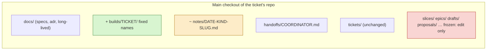
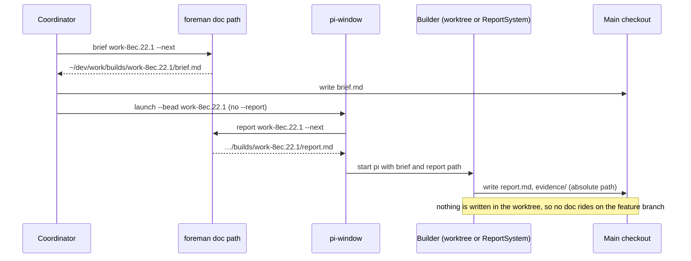
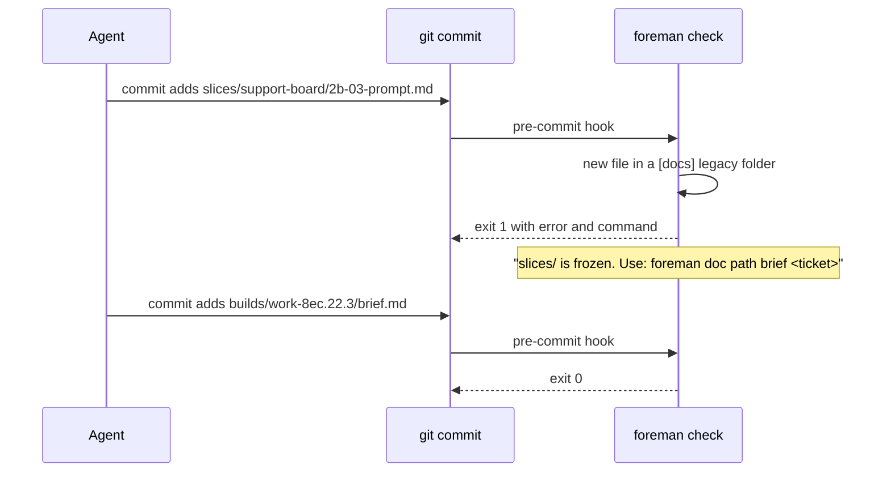
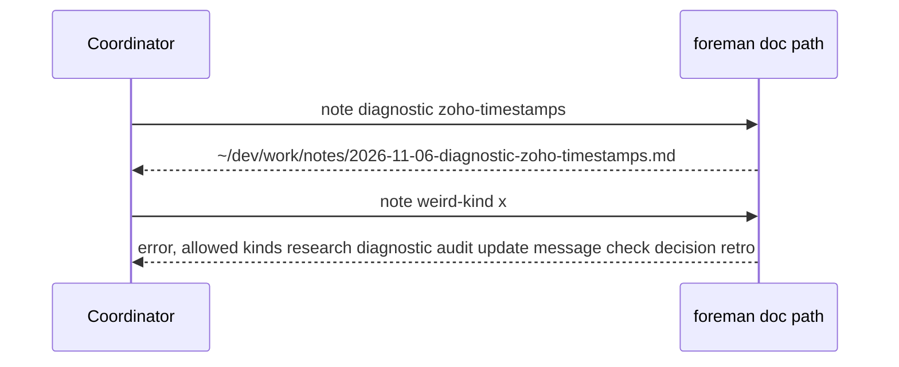
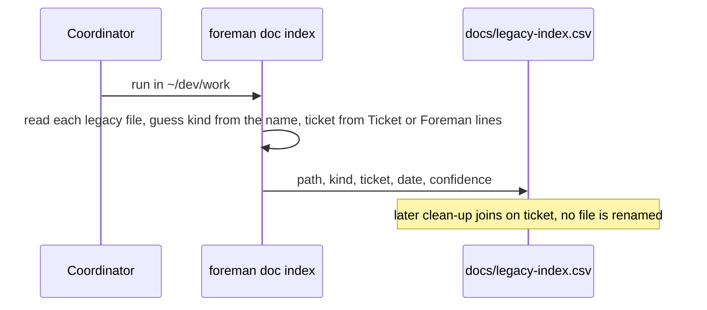

# Design pack: one layout for agent-written documents

Spec: `docs/specs/doc-layout.md` · Drawn at: foreman 5e80d09 · Legend: green = added, amber = changed, red = removed or frozen

## Data

No database change. The board keeps its stored brief and report paths (`sessions.details`, `agent_receipts`,
`stage_events`, `agent_notes`: about 700 rows into `~/dev/work`) as history.

**Files: one real ticket, now and proposed.** Support Board 2b slice 1 (work-8ec.22.1), from
`find ~/dev/work/slices` on 2026-11-06:

```text
NOW (15 files, 4 folders, 3 spellings of the slice)
slices/
├── support-board/
│   ├── 2b-01-grouping-prompt.md        brief
│   ├── 2b-01-fixes-r1.md … -r3.md      fix briefs
│   ├── msg-2b-01-r1.md … -r4.md        messages
│   ├── 2b.loop.md                      loop state (named for the phase, not the slice)
│   ├── reports/2b-01-grouping-r1.md … -r4.md
│   └── reviews/2b-01-grouping-r1.md
└── pr-bodies/sb-2b-grouping.md         PR body (third spelling)

PROPOSED (same 15 files, 1 folder, named by ticket)
builds/work-8ec.22.1/
├── brief.md   brief-r2.md   brief-r3.md   brief-r4.md
├── message-r1.md … message-r4.md
├── loop.md
├── report.md  report-r2.md  report-r3.md  report-r4.md
├── review.md
├── pr.md
└── evidence/          (git-ignored)
```



## State

Skipped: no state machine. `foreman check` and `foreman doc path` are stateless reads of the file tree and
`foreman.toml`.

## Flows

**1. Dispatch a build: the brief and report paths come from the CLI.**



**2. Commit: the pre-commit check refuses an invented name.**



**3. A note that belongs to no single ticket.**



**4. Old files: indexed once, not moved.**



## UI

Skipped: no board screen changes. The board's document list keeps showing `README.md`, `AGENTS.md` and
`docs/**/*.md`, so new specs still appear there; `builds/` is out of scope (spec non-goal).
