# Design pack: question cards on Needs you, and the Answers page

Spec: `docs/specs/question-cards.md` · Drawn at: foreman 9c27e13 (main after the fm-fdw merge) · Legend: green = added, amber = changed, red = removed

The Proposed machines are **hand drafts, not model-checked**. `statechart` is user-invoked; the rules below were checked by hand against the state tables. Ryan can run `/statechart` on the card list machine before the build.

## Data

Skipped: no schema change. The spec adds no table, column or migration (spec Non-goals).

What the changed screens read, for context:

| Table | Read by | What for |
| --- | --- | --- |
| `approval_requests` (pending) | Needs you list, drawer rows | the cards: `kind`, `facts` (question, text, options, option details), `session`, `inserted_at`, `edited_at` |
| `approval_requests` (answered; kind decision, review_ui, batch) | Answers, Your answers tab (new read) | `facts.question`, `outcome.answer`, `note`, `session`, `updated_at`. 271 rows on 2026-11-03 (critique) |
| `answers`, `answer_versions` | Answers, Saved answers tab | as today |
| `standing_answers` | Answers, Always rules tab | as today (0 rows on 2026-11-03) |
| `sessions` (dispatch rows) | card source row, fallback | name match and `ended_at`, as today in `RequestSource.for_request/2` (`lib/foreman/request_source.ex:5-54`) |
| `agent_sessions` | card source row, after the Sessions work | proposed by the Sessions pack (`docs/specs/sessions-view.design.md`, Data, Proposed); not built at 9c27e13 (no `agent_session` in `lib/`) |

## State

### Now

**The card list has no machine.** The Needs you LiveView keeps the list in a stream plus loose assigns: `pending_ids`, `pending_versions`, `pending_headings` (`lib/foreman_web/live/needs_you_live.ex:6-18`), rebuilt by `refresh/1` (`:295-329`). Each stream item carries three card fields, `card`, `focus` and `question`, set by `item/3` (`:221-251`). Every card renders fully open (`:363-381`). An action error is a page flash, "Request not updated" (`:292-293`). The footer actions are `
` elements with no board state: Wrong question (`:600-629`, placed at `:586`), Withdraw (`lib/foreman_web/components/request_context.ex:106-126`).

Machines the feature touches, drawn from their generated docs at 9c27e13:

from: `docs/machines/request_drawer.md` (`Foreman.RequestDrawer`, `lib/foreman/request_drawer.ex`). Unchanged; the drawer shows rows instead of cards.

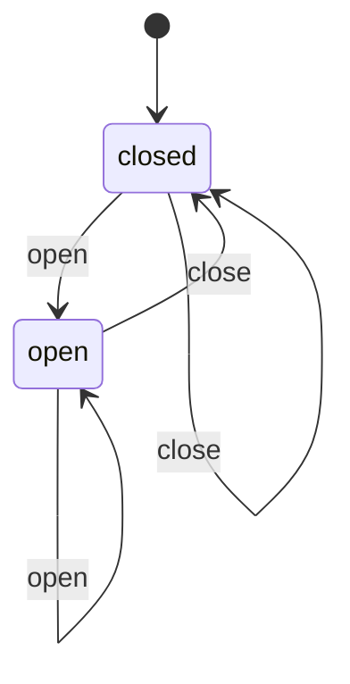

from: `docs/machines/card_panel.md` (`Foreman.CardPanel`, `lib/foreman/card_panel.ex`). Unchanged; under 1024 px it renders as a right sheet instead of full screen (`needs_you_live.ex:455`).

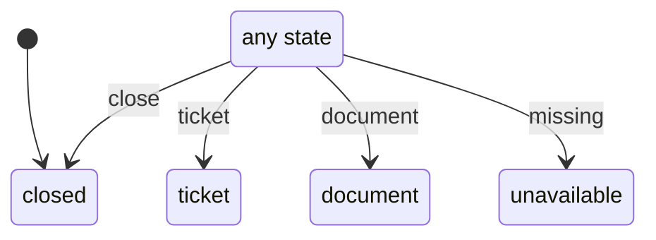

from: `docs/machines/waiting_card.md` (`Foreman.WaitingCard`, `lib/foreman/waiting_card.ex`). Unchanged; its states now feed the shared info line under the source row (spec Decisions 19, 20) instead of the copy-command box.

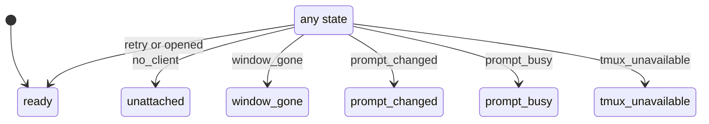

from: `docs/machines/expansion.md` (`Foreman.Answers.Expansion`). Unchanged; it still opens one Saved answers row by `?id=`.

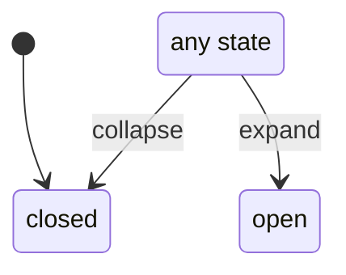

One hop: `Foreman.Request` (`docs/machines/request.md`, `lib/foreman/request.ex`). Unchanged. Only the events a card fires are drawn. The list machine's `resolved` follows each of these when the request leaves `pending`.

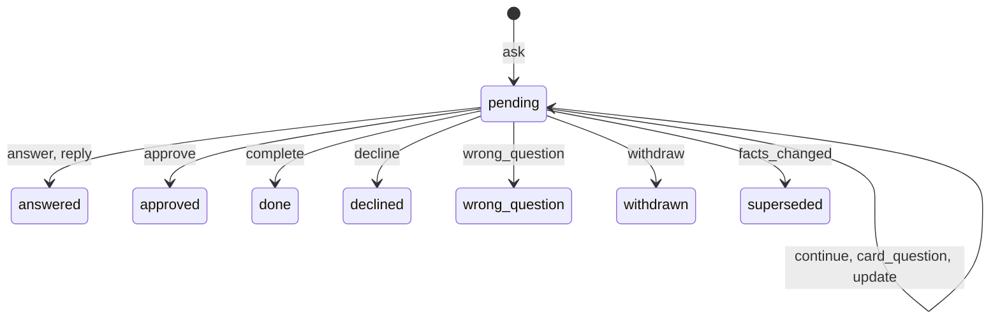

### Proposed: card list (`Foreman.CardList`, new)

From the spec's Decision 39 table. Hand draft.

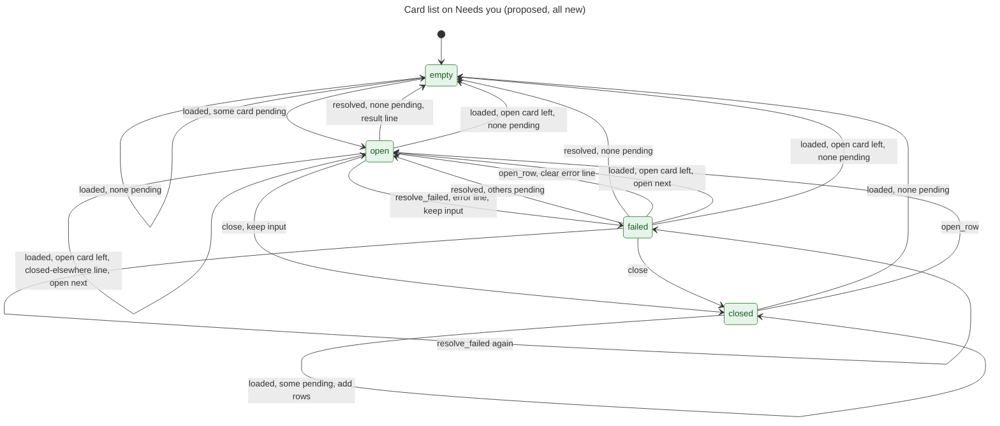

Not drawn, to keep the chart readable: `line_expired` and `load_failed` (every state, stays), `open_row` for a card that is not pending (stays, stale-link line), and `loaded` while the open card is still pending (stays, add rows).

Events, guards and who fires them:

| Event | Source | Guard(s) | Fired by |
| --- | --- | --- | --- |
| `loaded` | observed | some pending / none pending / open card still pending / open card left | mount, the 3 s poll, the events notification |
| `load_failed` | observed | | the list query fails |
| `open_row` | claimed | that card is pending | a row click, Enter or Space on a row, the `?card=` parameter, the drawer Open |
| `close` | claimed | | Close card button |
| `resolved` | claimed | others pending / none pending | the result of Answer, Submit, Approve, Done, Decline, Reply, Wrong question or Withdraw when the request left `pending` |
| `resolve_failed` | claimed | | the same actions when they return an error |
| `line_expired` | observed | | the 10 s timer of a result line |

Rules checked by hand (spec R1–R9):

- R1 one open card: holds. The data has one open id; every path to `open` or `failed` replaces it.
- R2 a poll never moves the open card: holds. `loaded` with the open card still pending stays and only adds rows.
- R3 input kept on close or switch: holds for your own actions (`close`, `open_row` keep input).
- **R3 broke on one path, fixed in the spec.** Path: you type a note on the open card → the agent withdraws it → `loaded` sees the card left → the card and your note go. Fix: the closed-elsewhere line shows the note in a copy field (spec Decisions 10, 31).
- R4 result line, then next: holds on every `resolved` row.
- R5 failure keeps input and says why: holds (`resolve_failed` → `failed`, keep input, error line).
- R6 no silent vanish: holds. Each way out of `open` or `failed` writes a line (result, closed-elsewhere) or comes from Close card.
- R7 empty box and no open card: holds. `empty` is reached only when none is pending, and has no open id.
- R8 result line goes after 10 s: holds (`line_expired`). Recent outcomes is outside this machine.
- R9 error line stays until your next action: holds. Only `open_row`, `close` and a new `resolved` or `resolve_failed` on that card clear it; `loaded` does not.

Formal check: not recommended. The machine guards UI state only. The costly part, what happens to a request, stays on the unchanged request machine.

### Proposed: footer panel (`Foreman.CardFooterPanel`, new)

Superseded (Ryan, 2026-11-04, cards 602ad7c1 and 8ff81918): no footer panel opens, so this machine was not kept. The card has one text box, and Ask's send state is `Foreman.CardAsk` (spec Decision 40, `docs/machines/card_ask.md`).

From spec Decision 40. Replaces the `
` elements named in Now.

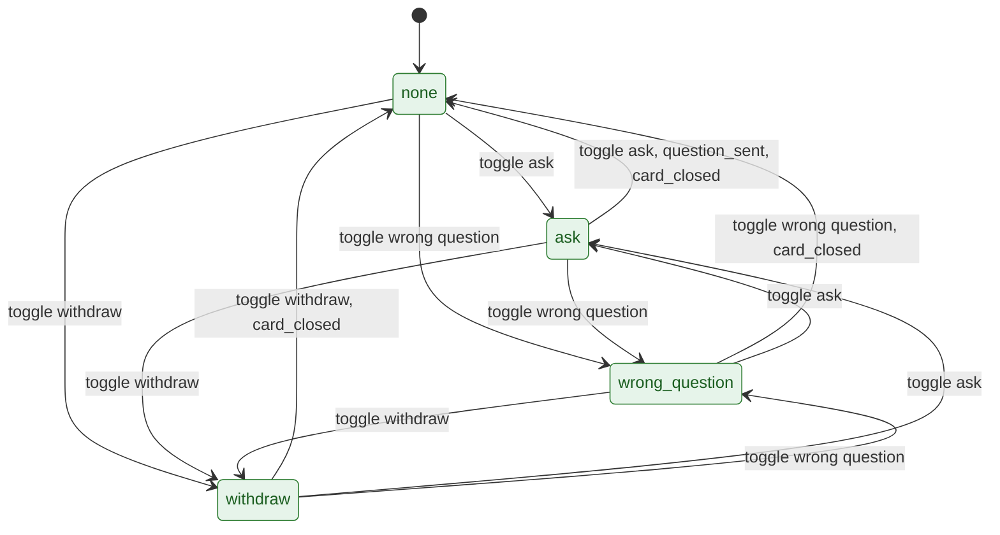

Fired by: the three text actions in the footer (`toggle`), a sent question (`question_sent`), and the card list closing or switching the card (`card_closed`). Rules: P1 at most one panel open (holds: one state). P2 opening a panel scrolls the card to the top (an effect on every `toggle` into a panel).

### Proposed: Answers tab (`Foreman.Answers.Tab`, new)

From spec Decision 41. URL-driven, like `Foreman.CardPanel`.

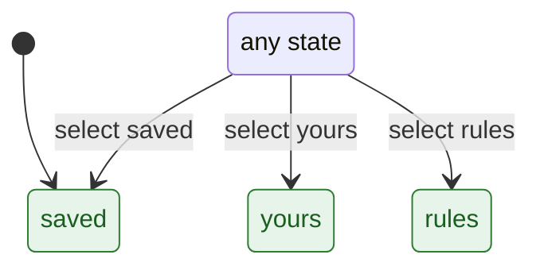

## Flows

### F1. Answer a decision card, then the next opens

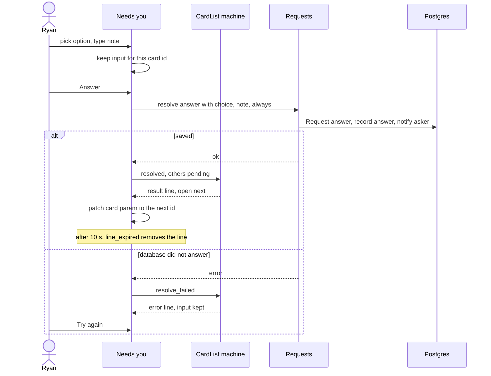

### F2. The open card closes elsewhere during a poll

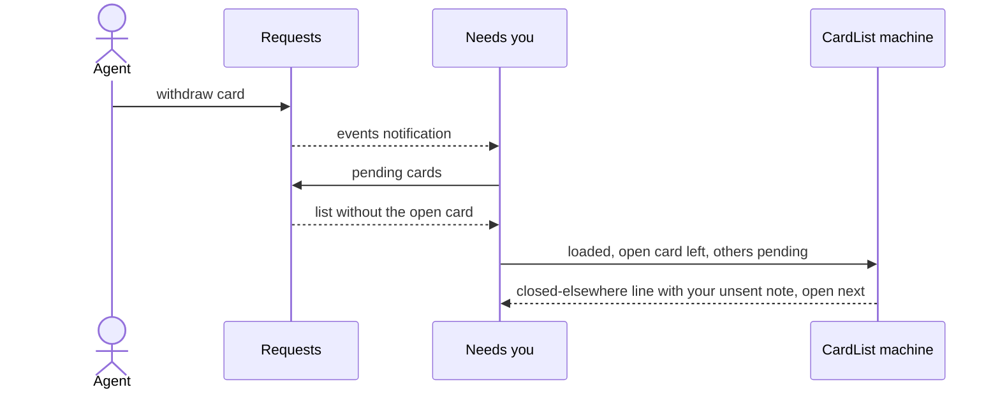

### F3. From the drawer to the card

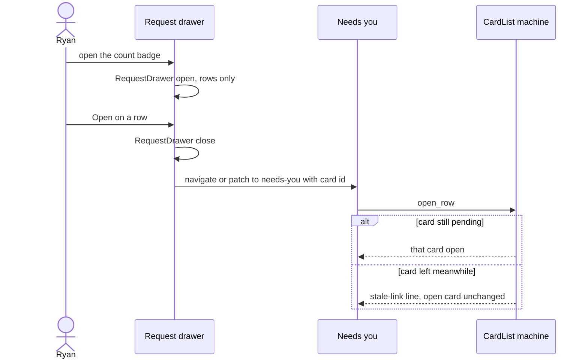

### F4. Ask about this when the board does not know the source

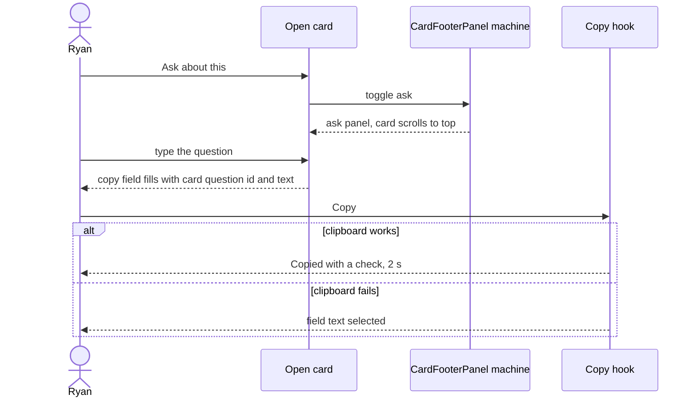

### F5. Find a past decision on Answers

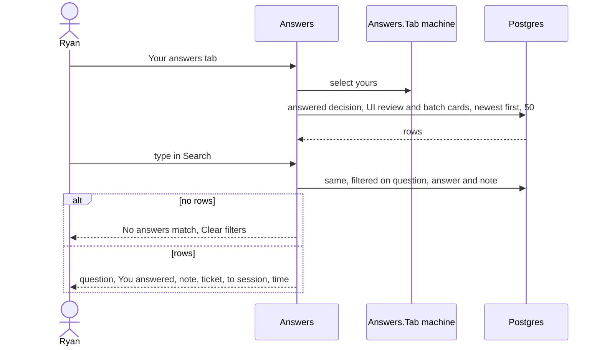

Every state event in the spec shows in a flow: `loaded` (F2), `open_row` (F3), `resolved` and `resolve_failed` (F1), `line_expired` (F1), `toggle` (F4), `select` (F5). `close`, `load_failed`, `question_sent` and `card_closed` are one-step events with no other component; they are in the state tables.

## UI

Mockups (built from the board's compiled CSS and real `foreman_dev` cards, 1440 and 820, light and dark; already critiqued with `ux-critique`, `ux-laws` and `ui-patterns`):

- Published: https://claude.ai/artifact/KkSwALbmBHC1TZg1vJf3jW (switcher: option, page, state, width, theme). Option C is the pick.
- Local: `docs/specs/question-cards-mockups/question-cards.html`; critique `question-cards-critique.md`; PNGs named `<option>-<page>-<state>[-dark]-<width>.png`.
- Shared source row: https://claude.ai/artifact/3tu2g2ucMsvuV3UdcpcWMG ("Card source row" option), `docs/specs/sessions-view-mockups/sd-card-source-row-1440.png` and `-820.png`, critique `session-detail-critique.md` ("Card source row (Needs you), before and after").

### Now (from the code)

| Part | Now | Where |
| --- | --- | --- |
| Card list | every card fully open, 798 px push card, 1 card starts in the first view at 1440 | `needs_you_live.ex:363-381`; audit `needs-you-top-1440.png` |
| Session named 3 times | "Source: …" line, header strip actor and session, Go to session button | `request_context.ex:47-64`; `needs_you_live.ex:995`, `:1079` |
| Board context block | Kind / Part of / From from the ticket | `request_context.ex:33-46`; `lib/foreman/request_header.ex:42-49` |
| Copy command box at load | when the source is unknown | `request_context.ex:80-105` |
| "This session has ended." | no time, no next step | `request_context.ex:65-71` |
| Actions outside the border | Wrong question, Ask about this | `needs_you_live.ex:586-597`; `card_conversation.ex:60-161` |
| Always with no gap | label "Always" | `needs_you_live.ex:1153-1159` |
| Panel at 820 | `fixed inset-0`, covers the page | `needs_you_live.ex:455` |
| Drawer | full cards at 640 px | `request_drawer.ex:105-165` (cards at `:151`) |
| Flashes | info and error both plain `bb-panel` | `layouts.ex:180-195` |
| Answers | centred column, unstyled inputs, "Standing answers" section, actor and session words | `answers_live.ex:82-95`, `:96-126`, `:146-151` |

### States per changed screen

Copy is in the spec; this table maps each state to its mockup and spec decision.

| Screen | State | Mockup | Spec |
| --- | --- | --- | --- |
| Needs you | Default (1 open, rows) | `C-needs-you-default-1440.png`, `-820`, `-dark-*` | 1-3, 12 |
| Needs you | Sending | `C-needs-you-sending-1440.png`, `-820` | 29 |
| Needs you | Result line, next open | `C-needs-you-sent-1440.png`, `-820`, `-dark-1440` | 30 |
| Needs you | Error line | `C-needs-you-error-1440.png`, `-820`, `-dark-1440` | 32 |
| Needs you | Copied (unknown source) | `C-needs-you-copied-1440.png`, `-820`, `-dark-1440` | 18, 22 |
| Needs you | Empty | `C-needs-you-empty-1440.png`, `-820` | 29 |
| Needs you | Loading | `C-needs-you-loading-1440.png`, `-820` | 29 |
| Needs you | Ticket panel, sheet at 820 | `C-needs-you-panel-1440.png`, `-820`, `-dark-1440` | 25 |
| Needs you | Closed elsewhere, stale link, list load failed, focus failed, Continue sent | not mocked | 31, 29, 19 |
| Drawer | Rows | `C-answers-drawer-1440.png`, `-820`, `-dark-820` | 27 |
| Answers | Saved answers default | `C-answers-default-1440.png`, `-820`, `-dark-*` | 33-35 |
| Answers | Answer open | `C-answers-open-1440.png`, `-820` | 35 |
| Answers | Copied link | `C-answers-copied-1440.png`, `-820` | 35, 38 |
| Answers | Archived (info flash) | `C-answers-archived-1440.png`, `-820` | 38 |
| Answers | Your answers | `C-answers-yours-1440.png`, `-820` | 36 |
| Answers | No match | `C-answers-empty-1440.png`, `-820` | 38 |
| Answers | Loading, Error | `C-answers-loading-*`, `C-answers-error-*` | 38 |
| Answers | Always rules tab, empty Saved or Your answers | not mocked (the Always rules empty line shows in the default view) | 37, 38 |

### Critique findings

Fixed in the mockup (critique, option C): the open card has a Close card button; a panel that opens scrolls the card to the top; only the sheet shows under 1024 px; Show archived is hidden on Your answers; skeleton bars use `--border-base`.

Changes in the spec after the critique, from Ryan's later picks:

- Source row: "Live or ended" (no state badge) replaces the badge the audit asked for. The mockup already draws it.
- Negative actions: Decline next to Answer; Wrong question and Withdraw at the right end of the footer. The mockup already draws it.
- Context: parsed from the card text; no new CLI fields.

Left open:

- At 820 a row's question cuts off at about 40 characters (severity 1). The full text is in the tooltip.
- To compare two cards you open them one after the other (severity 2). Ryan picked one open card at a time; drafts are kept (spec Decision 8), so switching costs no input.
- States the spec adds that are not mocked (table above). They use the three shared line styles, so no new visual parts. A build check: take `verify ui` screenshots of each.
- `ux-critique` was not run again on the spec: no mockup changed after the critique.
