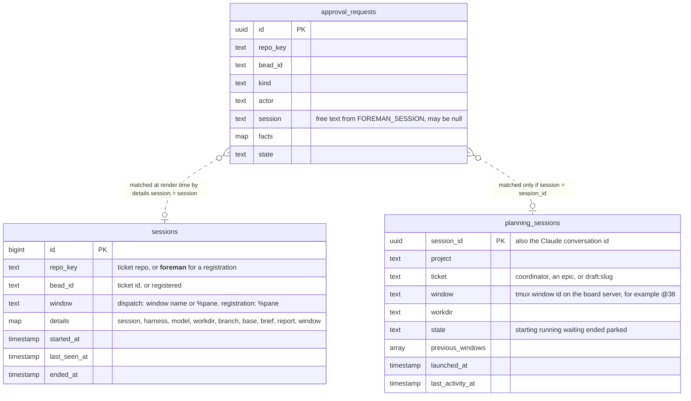
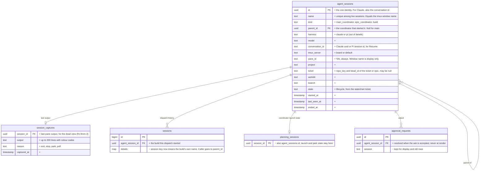
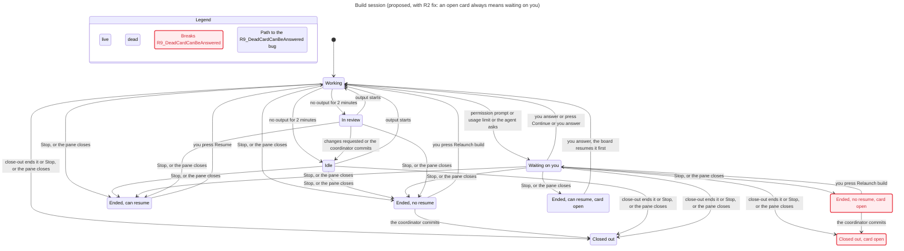

# Design pack: Sessions (live tree and session detail)

Spec: not written yet (wayfinder map fm-9mm) · Drawn at: foreman 83066bb · Legend: green = added, amber = changed, red = removed

This pack grows ticket by ticket. The Data part comes from "Session identity: how every ask, build and coordinator records its own name and parent" (fm-9mm.1). The State, Flows and UI parts come from later tickets on the map.

## Data

### Now

from: migrations `20261018050131_add_stage_overlay`, `20261018171858_create_approval_requests`, `20261018230608_create_planning_sessions` (+ `20261019010353`, `20261019011939`); writers `Overlay.persist_effect({:record, :session}, …)` (overlay.ex:347), `SessionRegistry.register/1` (session_registry.ex:39), `Sessions.launch/2`; reader `RequestSource.for_request/2` (request_source.ex:8).

Facts on 2026-11-02 (read-only counts on `foreman_dev`):

| What | Count |
| --- | --- |
| `sessions` dispatch rows | 149 (4 open). 93 store a `%pane`, the rest a window name. 44 have no `details.session` |
| `sessions` registrations (`__foreman__/registered`) | 14 (9 open) |
| `planning_sessions` | 3 (1 ended, 2 parked) |
| `approval_requests` | 524. 101 have no `session` |

What is wrong in Now:

1. **No identity of its own.** A session is a name in a JSON field. A request points at it by text, matched again on every render. Nothing makes the name unique or correct.
2. **Dispatch stores the caller's name.** `foreman dispatch` copies `FOREMAN_SESSION` into `details.session`. When an epic coordinator dispatches a build, that is the coordinator's name, so the build row claims to be the coordinator (40 cards in the 2026-11-01 diagnosis).
3. **Coordinators only exist if someone registers them.** Launches outside the board (`coord`, relay windows) make no row until `foreman session register` runs by hand, and window names drift from session names (59 cards).
4. **Asks can have no session.** `foreman ask` sends `session = nil` when `FOREMAN_SESSION` is unset (101 requests).
5. **No parent, no conversation id for builds.** Nothing links a build to its coordinator, and Pi's session id is not stored, so a build cannot be resumed (fm-9mm.2).
6. **Two identity tables.** Board-launched coordinators live in `planning_sessions` with a UUID; everything else lives in `sessions` with a bigint and a name.

### Proposed

How each writer fills it:

| Who starts the session | Writes `agent_sessions` | Name | Parent |
| --- | --- | --- | --- |
| Board launch (main or epic coordinator) | `Sessions.launch/2`, same transaction as `planning_sessions` | the window name the board picks | main coordinator for epic coordinators |
| `coord` / `foreman coordinator` outside the board | `foreman session register` called by the launch script itself, with `$TMUX_PANE` | window name | as above |
| `pi-window` (window or pane build) | `foreman dispatch --name <build> --pi-session <uuid>`, from `pi-window` | the build window name, never `FOREMAN_SESSION` | the caller's `FOREMAN_SESSION`, resolved to its row |
| Relay / slice-loop build | the relay `open` step calls `foreman session register --parent <coordinator>` | relay window name | coordinator |

How an ask finds its session: the CLI always sends `FOREMAN_SESSION` **and** `$TMUX_PANE`. The server resolves by name first, then by live pane id. It stores `agent_session_id` on the request at that moment.

### Decisions (Ryan, 2026-11-02, fm-9mm.1)

- **D1 New table.** `agent_sessions` is the only identity; `planning_sessions`, dispatch `sessions` rows and requests point at it. A view over today's tables was rejected because it keeps the name matching.
- **D2 Accept and warn.** An ask resolves by name, then by `$TMUX_PANE`. If neither matches, the board accepts it, the card says "source unknown" and the agent gets a warning. Refusing was rejected because it stops a build mid-question.
- **D3 No backfill.** The 524 old requests keep their text name and show "source unknown" when it does not match. New identity applies from the migration on.
- **D4 Unique among live sessions.** A name can be reused after the old session ends; old cards still point at the old row by id and open its dead view.

| Migration | What it does | Reversible | Backfill | Rows |
| --- | --- | --- | --- | --- |
| create `agent_sessions` | new identity table, partial unique index on `name` where `ended_at is null` | yes (drop) | from the 14 registrations and 3 planning rows; dispatch rows only when they have a pane id and their own name | 17 + up to 93 |
| create `session_captures` | last output per session | yes | none | 0 |
| alter `sessions` add `agent_session_id` | link dispatch history to the build | yes | as above | ≤ 149 |
| alter `approval_requests` add `agent_session_id` | the card's source, fixed at ask time | yes | none (D3) | 0 |

## State

Ticket: "Session lifecycle statechart: states, events and the three user-facing labels" (fm-9mm.5). The Proposed chart below is a **hand draft, not model-checked yet**. It is the input for `/statechart`, which Ryan runs.

### Now

Three machines touch a session today. None of them covers a Pi build: a build has only a dispatch row and the ticket's stage.

- `Foreman.SessionMachine` (board-launched coordinators, `planning_sessions.state`). from: `docs/machines/session_machine.md`, generated by `mix foreman.fsm.docs` at 83066bb. States `new → starting → running ⇄ waiting → ended | parked`. `idle_timeout` parks a session only when `parkable?` (not the main coordinator); `window_gone` ends the main coordinator but parks the others; `relaunch` from `parked | ended` opens the same conversation again.
- `Foreman.ExternalSession` (registrations in `sessions`). from: `lib/foreman/external_session.ex`. Only `running → ended` on `pane_gone`, and `register` back to `running`.
- `Foreman.Stage` (the ticket, not the session). from: `docs/machines/stage.md`. `dispatched, building` = the build works; `reported, in_review` = the coordinator reviews it; `committed` and later = the build is finished.
- The card's own focus result (`WaitingCard`: `ready, unattached, window_gone, prompt_changed, prompt_busy, tmux_unavailable`) is where today's error boxes come from. from: `docs/machines/waiting_card.md`.

### Proposed (draft for /statechart)

One machine for every `agent_sessions` row, with `kind` as a guard. "Live" means the pane exists.

| State | Parent | Meaning | Comes from |
| --- | --- | --- | --- |
| `starting` | live | launched, no output yet | launch, register |
| `working` | live | output changed in the last 2 minutes | pane activity (monitor) |
| `idle` | live | no output change for 2 minutes, nothing pending | monitor |
| `waiting.question` | live | a pending card has this `agent_session_id` | `foreman ask` accepted |
| `waiting.permission` | live | the agent shows a permission prompt | `SessionWaiting` |
| `waiting.usage_limit` | live | the agent hit a usage limit | `SessionWaiting` |
| `parked` | dead | a coordinator closed by idle timeout or Park; can Relaunch | `idle_timeout`, Park |
| `ended` | dead | the pane is gone, or Stop | `exited`, `pane_gone`, Stop |

The label on the page comes from the state, plus the ticket stage for builds:

| Label | When |
| --- | --- |
| **waiting on you** | any `waiting.*` state. Wins over every other label |
| **in review** | a build that is `idle` and its ticket stage is `reported` or `in_review` |
| **working** | `starting` or `working` |
| idle | `idle` and not in review |
| ended / parked | dead states, with the time |

Controls by state:

| Control | Allowed in | Notes |
| --- | --- | --- |
| Focus terminal | every live state | |
| Send message | `idle`, `waiting.question` | typing into a working pane interrupts the agent |
| Answer | `waiting.question`, `waiting.permission` | opens the card or the inline answer |
| Continue | `waiting.usage_limit` | sends `continue` + Enter to that pane only (fm-3c3.9) |
| Park | coordinators, live | not the main coordinator |
| Stop | every live state | confirm names the session; the worktree is kept |
| Resume | `parked`, `ended` | Claude: conversation id exists. Pi: conversation id, worktree and session file exist (fm-9mm.2) |
| Relaunch build on this ticket | `ended` build without Resume | resumes the parent coordinator first if it is dead, then sends it the note (R8) |

Rules for `/statechart` to check:

- R1 Every session has exactly one label at all times.
- R2 A pending card makes the session "waiting on you", whatever else is true.
- R3 A dead session never offers Focus, Send message, Continue, Park or Stop.
- R4 Resume shows only when its conditions above hold. Otherwise a dead build offers Relaunch, and a dead coordinator offers Start fresh.
- R5 Stop never deletes the worktree or the branch.
- R6 The main coordinator is never parked by idle timeout.
- R7 At most one live session has a given name.
- R8 *(Ryan, 2026-11-02)* When a coordinator ends, its live builds keep running and stay under it in the tree with a "parent ended" note. Relaunch build on a dead build first resumes its coordinator, then sends it the note.
- R9 *(Ryan, 2026-11-02)* When a session ends with a pending card, the card stays open and says the session ended. If the session can resume, answering resumes it first and then delivers the answer. If it cannot, the answer goes to its parent coordinator as a note with the question, and the card closes.

### Check (statechart, 2026-11-02)

Model: one coordinator and one build it started (`Sessions.tla`, 1,792 states), plus one build alone for the chart (`Build.tla`, 51 states). Files and rerun: `/private/tmp/claude-504/-Users-ryanmessner-dev-work/445516f3-3607-44fe-9f1c-d5ce9debd526/scratchpad/statechart`, `~/.claude/skills/statechart/scripts/statechart Sessions.tla --config Sessions.cfg --view view.ts --out <new dir>` (and `Build.tla --config Build.cfg --view bview.ts`).

Rules that hold: R1, R3, R4, R5, R6, R10 (every dead build has Resume, Relaunch, or is committed). R3-R5 hold because the control table defines them that way; the check shows the table does not contradict itself, not that code will obey it. R7 (one live session per name) is not modelled: the model has one session of each kind.

Rules that break:

- **R2 breaks, fixed in the draft** (open card, ended session). Path: the coordinator asks a question → you press Stop → the session label says Ended while its card is still open. Fix applied in the chart below: an open card always makes the label "waiting on you", with "ended" as a second line.
- **R8 breaks** (Relaunch build with no live coordinator). Path: you stop the coordinator → you stop the build, which has no Pi session id → the dead build offers "Relaunch build", which sends a note to a coordinator that is not there. **Decided:** Relaunch build resumes the coordinator first (R8).
- **R9 breaks** (answer cannot be delivered). Path: the build asks → the build stops, and it cannot resume (no Pi session id, or close-out removed the worktree) → the card is open and its answer has nowhere to go. Today a ticket closing supersedes its pending cards, which covers the close-out case only. **Decided:** the answer goes to the parent coordinator as a note (R9).

Rendered report (chart, paths, rules): https://claude.ai/artifact/7Wqutsha9uYNtkox2JSaK3

Chart: one build session, with the R2 fix. Every state where a card is open after the session ended is marked; the R9 path is highlighted.

## Flows

Pending: drawn when the controls and launch tickets close (fm-9mm.7, fm-9mm.8).

## UI

Input: "UX audit of the current board" (fm-9mm.4), `docs/specs/sessions-view-audit/ux-audit.md`. Pending: "Sessions tree page" (fm-9mm.6), "Session detail page" (fm-9mm.7).
